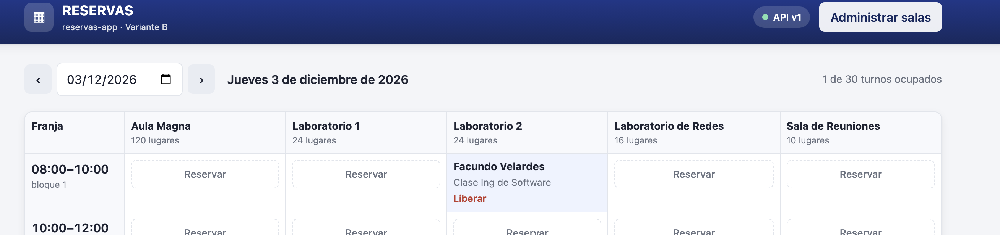
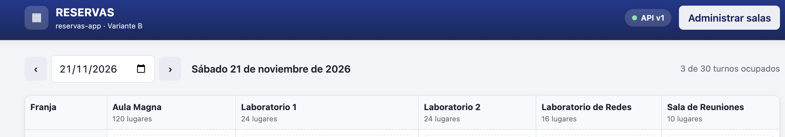
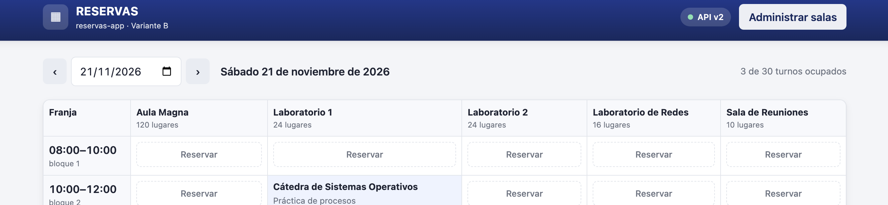
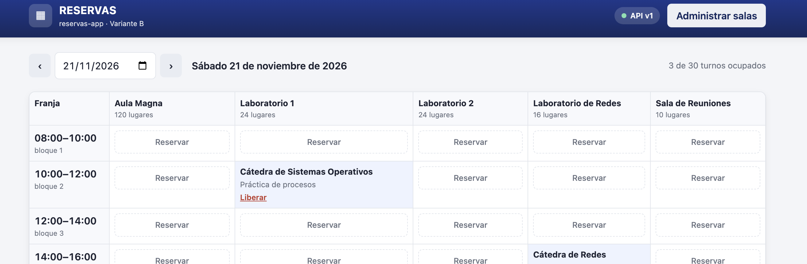

# INFORME — reservas-app (variante B)

Este informe reemplaza a la defensa oral: muestra, con capturas y registros de comandos, que el despliegue funciona. Cada evidencia incluye el comando que la produjo y una explicación de lo que se ve. Los registros completos, con la hora de cada comando, están en la carpeta [`informe/`](informe/). Las respuestas conceptuales están en [`ARQUITECTURA.md`](ARQUITECTURA.md).

Entorno: clúster Kubernetes del curso, de un nodo (`fvelardes`, 2 CPU), con `metrics-server` y el controlador `nginx-ingress` (IP `172.16.21.227`). La aplicación está instalada con Helm como la release `reservas-app` en el namespace `reservas-app`. `reservas.local` resuelve a la IP del controlador por `/etc/hosts`. Las horas son locales (UTC-3).

| # | Evidencia | Registro completo |
|---|---|---|
| 1 | La aplicación por el Ingress, con una reserva creada desde el navegador | [`informe/registro-ingress.md`](informe/registro-ingress.md) |
| 2 | `kubectl get hpa -w`: réplicas que suben bajo carga y bajan cuando cesa | [`informe/registro-hpa.md`](informe/registro-hpa.md) |
| 3 | `helm history` después de una actualización y su reversión | [`salidas-semana08.md`](salidas-semana08.md), consigna 7 |
| 4 | Un valor de `values.yaml` real: la misma plantilla renderizada dos veces | [`informe/registro-helm-template.md`](informe/registro-helm-template.md) |
| 5 | La prueba de concurrencia de la sexta entrega (pregunta 2 de `ARQUITECTURA.md`) | [`informe/registro-concurrencia.md`](informe/registro-concurrencia.md) |
| — | Evidencia complementaria: Compose e imágenes | [`informe/registro-compose-e-imagenes.md`](informe/registro-compose-e-imagenes.md) |

---

## 1. La aplicación respondiendo a través del Ingress, con una reserva creada desde el navegador



La captura muestra la aplicación abierta en `http://reservas.local` con una reserva creada desde el formulario de la grilla: Laboratorio 2, jueves 3 de diciembre de 2026, franja 08:00–10:00, responsable "Facundo Velardes", motivo "Clase Ing de Software". El indicador "API v1" de la barra superior confirma que el frontend llega a la API. Al pie de esta sección, la misma reserva leída desde la API por el Ingress.

El recorrido del pedido se ve en estos comandos:

```
$ kubectl get ingress -n reservas-app
NAME                   CLASS   HOSTS            ADDRESS         PORTS   AGE
reservas-app-ingress   nginx   reservas.local   172.16.21.227   80      16h

$ kubectl describe ingress reservas-app-ingress -n reservas-app
Rules:
  Host            Path  Backends
  ----            ----  --------
  reservas.local
                  /   reservas-frontend:8080 (10.244.0.109:8080,10.244.0.108:8080)
Annotations:      meta.helm.sh/release-name: reservas-app

$ curl -s -o /dev/null -w "%{http_code} %{content_type}\n" http://reservas.local/
200 text/html

$ curl -s http://reservas.local/api/health
{"status":"ok","db":"ok","version":"v1"}

$ curl -s -o /dev/null -w "%{http_code}\n" http://172.16.21.227/
404
```

- El Ingress tiene `ADDRESS 172.16.21.227` y una sola regla: el host `reservas.local` va a `reservas-frontend:8080`, con las IPs de los dos Pods del frontend como destino. La anotación `meta.helm.sh/release-name` muestra que el objeto lo creó la release de Helm.
- `/` devuelve la SPA (`200 text/html`) y `/api/health` llega a la API a través del proxy de nginx del frontend, que a su vez confirma la conexión con la base (`"db":"ok"`). No hay una regla de Ingress para `/api`: la API no está publicada y solo la alcanza el frontend (ver `ARQUITECTURA.md`, pregunta 1b).
- El mismo pedido a la IP **sin** el encabezado `Host: reservas.local` devuelve `404`, y lo responde el controlador: ninguna regla coincide. Es el nombre de host, no la IP, lo que selecciona la aplicación.

La reserva creada en la captura, leída desde la API por el mismo Ingress:

```
$ curl -s "http://reservas.local/api/reservas?fecha=2026-12-03"
[{"id":64,"sala_id":3,"sala":"Laboratorio 2","fecha":"2026-12-03","franja":1,"responsable":"Facundo Velardes","motivo":"Clase Ing de Software","creada_en":"2026-11-21 19:37:28"}]
```

La reserva existe en la base (`id` 64), tiene la fecha que se eligió en el navegador (sin corrimiento de día: `dateStrings: true` en el pool de `mysql2` evita que la fecha se convierta a `Date` en la zona horaria del proceso) y `creada_en` corresponde al momento en que se hizo la captura (19:37:28 en UTC, la zona de MySQL dentro del contenedor; 16:37 en hora local). El pedido entra por el mismo camino que el navegador: Ingress → `reservas-frontend` → proxy `/api/` → `reservas-api` → `reservas-db`.

---

## 2. El autoescalador bajo carga: `kubectl get hpa -w`

`reservas-api` declara `resources.requests.cpu: 100m`, que es el número contra el cual el HPA calcula su porcentaje. `reservas-api-hpa` va de 2 a 6 réplicas con un objetivo del 50% de CPU (50m promedio por Pod).

```
$ kubectl get deploy reservas-api -n reservas-app -o jsonpath='{.spec.template.spec.containers[0].resources}'
{"limits":{"cpu":"500m","memory":"256Mi"},"requests":{"cpu":"100m","memory":"128Mi"}}
```

La carga se generó desde el propio clúster con cuatro Pods temporales que piden en bucle el listado de reservas (que resuelve un `JOIN` entre `reservas` y `salas`):

```bash
for i in 1 2 3 4; do
  kubectl run carga-$i --image=busybox --restart=Never -n reservas-app -- \
    /bin/sh -c "while true; do wget -q -O- http://reservas-api:3000/reservas >/dev/null; done"
done
# ... y al terminar:
kubectl delete pod carga-1 carga-2 carga-3 carga-4 -n reservas-app
```

```
$ kubectl get hpa reservas-api-hpa -n reservas-app -w      # hora local antepuesta a cada línea
16:22:25  NAME               REFERENCE                 TARGETS       MINPODS   MAXPODS   REPLICAS   AGE
16:22:25  reservas-api-hpa   Deployment/reservas-api   cpu: 1%/50%   2         6         2          16h
16:22:31  reservas-api-hpa   Deployment/reservas-api   cpu: 1%/50%   2         6         2          16h
16:22:46  reservas-api-hpa   Deployment/reservas-api   cpu: 0%/50%   2         6         2          16h
16:23:16  reservas-api-hpa   Deployment/reservas-api   cpu: 250%/50%   2         6         2          16h
16:23:31  reservas-api-hpa   Deployment/reservas-api   cpu: 324%/50%   2         6         4          16h
16:23:47  reservas-api-hpa   Deployment/reservas-api   cpu: 247%/50%   2         6         6          16h
16:24:02  reservas-api-hpa   Deployment/reservas-api   cpu: 112%/50%   2         6         6          16h
16:24:17  reservas-api-hpa   Deployment/reservas-api   cpu: 117%/50%   2         6         6          16h
16:24:32  reservas-api-hpa   Deployment/reservas-api   cpu: 104%/50%   2         6         6          16h
16:24:47  reservas-api-hpa   Deployment/reservas-api   cpu: 102%/50%   2         6         6          16h
16:25:17  reservas-api-hpa   Deployment/reservas-api   cpu: 101%/50%   2         6         6          16h
16:25:32  reservas-api-hpa   Deployment/reservas-api   cpu: 31%/50%    2         6         6          16h
16:25:47  reservas-api-hpa   Deployment/reservas-api   cpu: 0%/50%     2         6         6          16h
16:27:32  reservas-api-hpa   Deployment/reservas-api   cpu: 1%/50%     2         6         6          16h
16:27:47  reservas-api-hpa   Deployment/reservas-api   cpu: 0%/50%     2         6         6          16h
16:30:17  reservas-api-hpa   Deployment/reservas-api   cpu: 0%/50%     2         6         6          16h
16:30:32  reservas-api-hpa   Deployment/reservas-api   cpu: 0%/50%     2         6         4          16h
16:30:47  reservas-api-hpa   Deployment/reservas-api   cpu: 0%/50%     2         6         2          16h
16:31:03  reservas-api-hpa   Deployment/reservas-api   cpu: 1%/50%     2         6         2          16h
```

Los Pods de carga se crearon a las **16:22:28** y se eliminaron a las **16:24:32**.

```
$ kubectl top pods -n reservas-app                          # 16:24:27, con 6 réplicas
NAME                                 CPU(cores)   MEMORY(bytes)
carga-1                              168m         2Mi
carga-2                              166m         1Mi
carga-3                              170m         1Mi
carga-4                              161m         1Mi
reservas-api-76cfd9c6c6-5n5n7        98m          30Mi
reservas-api-76cfd9c6c6-c76rx        97m          33Mi
reservas-api-76cfd9c6c6-fcmbh        119m         31Mi
reservas-api-76cfd9c6c6-q7hrc        95m          34Mi
reservas-api-76cfd9c6c6-r2rrt        114m         28Mi
reservas-api-76cfd9c6c6-rqnx2        104m         28Mi
reservas-db-6bbb6cb6cb-ptm69         153m         509Mi
reservas-frontend-5c986b9474-88zmn   0m           2Mi
reservas-frontend-5c986b9474-srkk4   0m           2Mi
```

- **`TARGETS` muestra un número desde el principio** (`1%/50%`) y no `<unknown>`, porque hay `metrics-server` y hay `requests`.
- **Subida.** 48 segundos después de lanzar la carga, la CPU promedio llegó a 250% (250m contra un request de 100m). El HPA pasó a **4** réplicas a las 16:23:31 y a **6**, el máximo, a las 16:23:47. No saltó directo a 6 porque por defecto cada paso de subida está limitado: como mucho duplica las réplicas o suma 4 Pods cada 15 segundos.
- **El consumo subió de verdad.** `kubectl top` muestra cada réplica entre 95m y 119m, frente a 1m en reposo. Con 6 réplicas el promedio quedó en ~100%, por encima del objetivo, porque el nodo tiene 2 CPU y los propios Pods de carga consumen ~665m: el HPA ya estaba en su máximo. El frontend siguió en **0m** durante toda la prueba (ver `ARQUITECTURA.md`, pregunta 1c).
- **Bajada.** La CPU cayó a 0% a las 16:25:47. Tarda un poco en caer porque los Pods de carga demoran en terminar y la métrica es un promedio sobre una ventana. Aun así, las réplicas se quedaron en 6 casi **5 minutos más**: recién a las 16:30:32 bajó a 4 y a las 16:30:47 a 2, el mínimo. Es la **ventana de estabilización de bajada** (300 segundos por defecto). El HPA toma la recomendación más alta de los últimos 5 minutos para no eliminar réplicas ante un valle momentáneo y tener que crearlas de nuevo enseguida.

La misma prueba, hecha en la semana 8 sobre los manifiestos aplicados con `kubectl`, dio el mismo patrón: 2 → 4 → 6 en 30 segundos, y 6 → 3 → 2 unos 5 minutos después de cortar la carga (`salidas-semana08.md`, consigna 3).

---

## 3. `helm history` después de una actualización y de su reversión

```
$ helm upgrade reservas-app ./reservas-app -n reservas-app \
    -f reservas-app/values-secret.yaml --set api.image.tag=v2 --wait --timeout 5m
Release "reservas-app" has been upgraded. Happy Helming!
REVISION: 2

$ kubectl get deploy -n reservas-app -o 'custom-columns=NAME:.metadata.name,IMAGE:.spec.template.spec.containers[0].image'
NAME                IMAGE
reservas-api        fvelardes/reservas-api:v2
reservas-db         mysql:8.4
reservas-frontend   fvelardes/reservas-frontend:v1

$ helm rollback reservas-app 1 -n reservas-app --wait --timeout 5m
Rollback was a success! Happy Helming!

$ helm history reservas-app -n reservas-app
REVISION  UPDATED                   STATUS      CHART               APP VERSION  DESCRIPTION
1         Fri Nov 20 23:54:56 2026  superseded  reservas-app-0.1.0  v1           Install complete
2         Sat Nov 21 15:53:37 2026  superseded  reservas-app-0.1.0  v1           Upgrade complete
3         Sat Nov 21 15:56:30 2026  deployed    reservas-app-0.1.0  v1           Rollback to 1

$ kubectl get deploy -n reservas-app -o 'custom-columns=NAME:.metadata.name,IMAGE:.spec.template.spec.containers[0].image'
NAME                IMAGE
reservas-api        fvelardes/reservas-api:v1
reservas-db         mysql:8.4
reservas-frontend   fvelardes/reservas-frontend:v1
```

| Revisión 1 (instalación) | Revisión 2 (`api.image.tag=v2`) | Revisión 3 (rollback a 1) |
|---|---|---|
|  |  |  |

- **El historial tiene tres revisiones.** El rollback no borra la revisión 2: crea una **revisión 3** con el contenido de la 1 (`Rollback to 1`). Por eso se puede volver a la 2 si hiciera falta.
- **El indicador de versión del navegador sigue a la imagen de la API**: `API v1` → `API v2` → `API v1`. Lo informa la API en `/api/health` a partir de `APP_VERSION`, horneada con `ARG`/`ENV` en su Dockerfile. Entre cada paso, `/api/health` respondió `{"version":"v2"}` y luego `{"version":"v1"}` (registros en `salidas-semana08.md`).
- **Cambiar el tag de la API no cambia el del frontend**: `reservas-frontend` sigue en `v1` en las tres revisiones. Son dos imágenes con ciclos de vida independientes y dos valores separados en `values.yaml` (`api.image.tag` y `frontend.image.tag`). En el upgrade solo se reemplazaron los Pods de la API; los de la base y el frontend conservaron su edad.
- **`helm upgrade` no hereda los valores de la instalación**: por eso se repite `-f reservas-app/values-secret.yaml` (las credenciales reales, no versionadas). Sin ese archivo, el Secret volvería a los valores de laboratorio de `values.yaml`.
- `APP VERSION` dice `v1` en las tres revisiones porque sale de `appVersion` en `Chart.yaml`, que no cambió. La versión que realmente corre la muestran la imagen del Deployment y el indicador.

---

## 4. Un valor de `values.yaml` es real y no decorativo: la misma plantilla renderizada dos veces

La verificación honesta es la inversa de "se instala sin errores": renderizar la misma plantilla con `helm template` cambiando un valor con `--set`, y comprobar que el manifiesto cambia de forma visible. `helm template` no toca el clúster.

**Plantilla `templates/hpa-api.yaml`, render 1 (valores por defecto) y render 2 (`--set`):**

```
$ helm template reservas-app ./reservas-app -n reservas-app -s templates/hpa-api.yaml
...
  minReplicas: 2
  maxReplicas: 6
  ...
          averageUtilization: 50

$ helm template reservas-app ./reservas-app -n reservas-app -s templates/hpa-api.yaml \
    --set hpa.minReplicas=3,hpa.maxReplicas=10,hpa.cpuUtilization=70
...
  minReplicas: 3
  maxReplicas: 10
  ...
          averageUtilization: 70
```

**Plantilla `templates/deployment-frontend.yaml`:**

```
$ helm template reservas-app ./reservas-app -n reservas-app -s templates/deployment-frontend.yaml | grep -E "replicas|image:"
  replicas: 2
          image: "fvelardes/reservas-frontend:v1"

$ helm template reservas-app ./reservas-app -n reservas-app -s templates/deployment-frontend.yaml \
    --set frontend.replicas=4,frontend.image.tag=v2 | grep -E "replicas|image:"
  replicas: 4
          image: "fvelardes/reservas-frontend:v2"
```

**Las diferencias, con `diff` entre los dos renders:**

```
$ diff <(helm template reservas-app ./reservas-app -n reservas-app -s templates/deployment-api.yaml) \
       <(helm template reservas-app ./reservas-app -n reservas-app -s templates/deployment-api.yaml --set api.image.tag=v2)
27c27
<           image: "fvelardes/reservas-api:v1"
---
>           image: "fvelardes/reservas-api:v2"

$ diff <(helm template ... -s templates/ingress.yaml) <(helm template ... -s templates/ingress.yaml --set ingress.host=reservas.example)
16c16
<     - host: reservas.local
---
>     - host: reservas.example

$ diff <(helm template ... -s templates/deployment-api.yaml) <(helm template ... -s templates/deployment-api.yaml --set api.replicas=4); echo "exit=$?"
exit=0

$ diff <(helm template ... -s templates/deployment-api.yaml) <(helm template ... -s templates/deployment-api.yaml --set hpa.enabled=false,api.replicas=4)
13a14
>   replicas: 4

$ helm template reservas-app ./reservas-app -n reservas-app | grep -c '^kind:'
12
```

- Los tags de **las dos** imágenes propias, las réplicas del frontend, los tres umbrales del autoescalador y el host del Ingress cambian el manifiesto: son parámetros reales.
- `api.replicas=4` **no produce cambio** (`diff` vacío, `exit=0`), y es intencional. Con el HPA activo la plantilla omite `spec.replicas` en el Deployment de la API, porque las réplicas son del autoescalador: si el chart fijara `replicas: 2`, cada `helm upgrade` devolvería la API a 2 réplicas en medio de un pico de carga. El valor tiene efecto solo con `hpa.enabled=false`, y el último `diff` lo demuestra: aparece `replicas: 4`.
- El chart renderiza exactamente **12** objetos. La tabla completa de valores y dónde impacta cada uno está en el `README.md`, semana 8, consigna 5.

---

## 5. La prueba de concurrencia de la sexta entrega

Acompaña a la pregunta 2 de `ARQUITECTURA.md`: con tres réplicas de la API, la consulta previa a la inserción no impide la doble reserva; lo que la impide es la restricción `UNIQUE (sala_id, fecha, franja)` que aplica MySQL.

### Sexta entrega (sobre los manifiestos de la semana 6)

Tres réplicas de la API y treinta `POST /reservas` simultáneos por la misma sala, fecha y franja, enviados al NodePort de depuración de esa entrega:

```
$ kubectl scale deployment reservas-api --replicas=3 -n reservas-app

$ for i in $(seq 1 30); do
    curl -s -o /dev/null -w "%{http_code}\n" -X POST \
      http://172.16.21.22:30501/reservas -H 'Content-Type: application/json' \
      -d '{"sala_id":2,"fecha":"2026-12-01","franja":5,"responsable":"R'$i'"}' &
  done | sort | uniq -c
   1 201
  29 409

$ kubectl exec deploy/reservas-db -n reservas-app -- \
    mysql -ureservas_user -p... reservasdb -e \
    "SELECT COUNT(*) FROM reservas WHERE sala_id=2 AND fecha='2026-12-01' AND franja=5;"
COUNT(*)
1
```

### Repetición sobre la release de Helm (2026-11-21, por el Ingress)

La misma prueba, repetida sobre el despliegue final y enviada por el Ingress, que es el camino real de los pedidos:

```
$ kubectl scale deployment reservas-api -n reservas-app --replicas=3
deployment.apps/reservas-api scaled

$ kubectl get pods -n reservas-app -l app=reservas-api -o wide
NAME                            READY   STATUS    RESTARTS   AGE   IP
reservas-api-76cfd9c6c6-c76rx   1/1     Running   0          20m   10.244.0.116
reservas-api-76cfd9c6c6-jrspn   1/1     Running   0          2s    10.244.0.117
reservas-api-76cfd9c6c6-q7hrc   1/1     Running   0          20m   10.244.0.115

$ for i in $(seq 1 30); do curl -s -o /dev/null -w '%{http_code}\n' -X POST \
    -H 'Host: reservas.local' -H 'Content-Type: application/json' \
    -d '{"sala_id":7,"fecha":"2026-12-02","franja":3,"responsable":"R'$i'"}' \
    http://172.16.21.227/api/reservas & done | sort | uniq -c; wait
   1 201
  29 409

$ kubectl exec deploy/reservas-db -n reservas-app -- sh -c \
    'mysql -u"$MYSQL_USER" -p"$MYSQL_PASSWORD" reservasdb -e "SELECT id, sala_id, fecha, franja, responsable FROM reservas WHERE sala_id=7 AND fecha=\"2026-12-02\" AND franja=3;"'
id  sala_id  fecha       franja  responsable
22  7        2026-12-02  3       R11

$ kubectl exec deploy/reservas-db -n reservas-app -- sh -c \
    'mysql -u"$MYSQL_USER" -p"$MYSQL_PASSWORD" reservasdb -e "SHOW CREATE TABLE reservas\G"' | grep -E 'UNIQUE|FOREIGN'
  UNIQUE KEY `sin_solapamiento` (`sala_id`,`fecha`,`franja`),
  CONSTRAINT `fk_reserva_sala` FOREIGN KEY (`sala_id`) REFERENCES `salas` (`id`) ON DELETE RESTRICT

$ kubectl scale deployment reservas-api -n reservas-app --replicas=2
```

(Las credenciales de MySQL se leen de las variables del propio contenedor, que vienen del Secret, para no escribirlas en la línea de comandos.)

- **Los dos resultados coinciden**: de 30 pedidos concurrentes, exactamente uno recibe `201 Created` y los otros 29 reciben `409 Conflict`. En la tabla hay **una sola fila** para esa sala, fecha y franja (la del pedido `R11`, que no fue el primero en enviarse: ganó el primero en llegar al motor).
- **Los 409 no salen todos del mismo lugar.** Algunos los devuelve el `SELECT` previo (pedidos que llegaron cuando la fila ya existía); otros, los que leyeron "libre" en paralelo y llegaron al `INSERT`, los devuelve MySQL con `ER_DUP_ENTRY`, que la API traduce al mismo `409`. Para el cliente son idénticos; la única barrera que no tiene ventana es la segunda.
- **`SHOW CREATE TABLE`** confirma que la restricción `sin_solapamiento` está aplicada en el motor, no solo declarada en el código.
- Durante la prueba el HPA mostraba `REPLICAS 3`: el escalado manual a 3 está dentro de su rango (2 a 6), así que no lo deshizo. Después se volvió a 2.

---

## Evidencia complementaria: Compose e imágenes

Para acreditar los criterios de imágenes y Compose, que no tienen una evidencia propia en la lista anterior. Registro completo en [`informe/registro-compose-e-imagenes.md`](informe/registro-compose-e-imagenes.md).

**Imágenes multietapa, sin herramientas de compilación, sin credenciales, con configuración en tiempo de ejecución:**

```
$ docker run --rm --entrypoint sh reservas-frontend:v1 -c "whoami; node --version; npm --version; ls /usr/share/nginx/html"
nginx
sh: node: not found
sh: npm: not found
50x.html
assets
index.html

$ docker run --rm --entrypoint sh reservas-api:v1 -c "whoami; node --version; echo APP_VERSION=$APP_VERSION"
node
v20.20.2
APP_VERSION=v1

$ docker run --rm --entrypoint sh reservas-api:v1 -c 'env | grep -iE "pass|secret|user" || echo sin credenciales en el entorno de la imagen'
sin credenciales en el entorno de la imagen
```

- El frontend final es nginx sin privilegios con solo `dist/`: no hay Node ni npm (la compilación quedó en la primera etapa). La API corre como el usuario `node`, no como root.
- Ninguna imagen trae credenciales: llegan en tiempo de ejecución (`.env` en Compose, el Secret en Kubernetes).
- Tamaños (tabla completa en el `README.md`, semana 2): `reservas-api` pasó de 1,59 GB (`node:20`, una etapa) a 324 MB (`node:20-slim`, multietapa); `reservas-frontend` pesa 76,2 MB.

**Compose: las tres capas con red propia, volumen de la base y comprobaciones de estado:**

```
$ docker compose up -d --wait
 Container reservas-app-reservas-db-1 Healthy
 Container reservas-app-reservas-api-1 Healthy
 Container reservas-app-reservas-frontend-1 Healthy

$ docker compose ps
NAME                               IMAGE                  STATUS                    PORTS
reservas-app-reservas-api-1        reservas-api:v1        Up 11 seconds (healthy)   0.0.0.0:3001->3000/tcp
reservas-app-reservas-db-1         mysql:8.4              Up 16 seconds (healthy)   3306/tcp, 33060/tcp
reservas-app-reservas-frontend-1   reservas-frontend:v1   Up 5 seconds (healthy)    0.0.0.0:3000->8080/tcp

$ docker network ls --filter name=reservas-net; docker volume ls --filter name=reservas-db-data
NAME           DRIVER
reservas-net   bridge
VOLUME NAME
reservas-db-data

$ curl -s localhost:3000/api/health
{"status":"ok","db":"ok","version":"v1"}

$ docker compose exec reservas-frontend sh -c "grep -n proxy_pass /etc/nginx/conf.d/default.conf"
24:        proxy_pass http://reservas-api:3000/;

$ docker inspect reservas-app-reservas-db-1 --format '{{json .Config.Healthcheck.Test}}'
["CMD-SHELL","mysqladmin ping -h 127.0.0.1 -u root -p\"$MYSQL_ROOT_PASSWORD\" --silent"]
```

- Los tres servicios llegan a `healthy` en orden (base → API → frontend), porque cada uno espera al anterior con `depends_on: condition: service_healthy`.
- La base no publica puertos (`3306/tcp` sin flecha): solo se alcanza desde `reservas-net`.
- La configuración generada por nginx al arrancar ya tiene `reservas-api:3000` en lugar de `${API_HOST}:${API_PORT}`: es la sustitución en tiempo de ejecución de la pregunta 1a de `ARQUITECTURA.md`, con la misma imagen que corre en Kubernetes.
- La comprobación de estado de la base quedó grabada con `$MYSQL_ROOT_PASSWORD` literal, no con la contraseña: el `$$` del `docker-compose.yml` hizo que la variable la expanda el contenedor y no Compose (`ARQUITECTURA.md`, sección 3.3).

**Configuración externalizada y persistencia en Kubernetes** (ConfigMaps, Secret y PVC): la demostración de que una reserva sobrevive a la eliminación del Pod de la base, con el datadir en el PVC, está en el `README.md`, semana 7, consignas 4 a 6, con sus registros en `salidas-semana07.md`.
