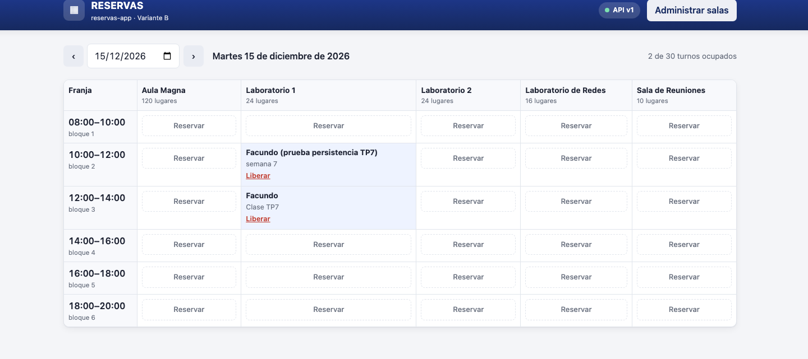
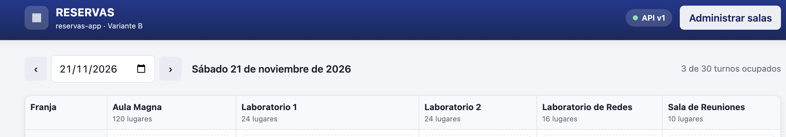
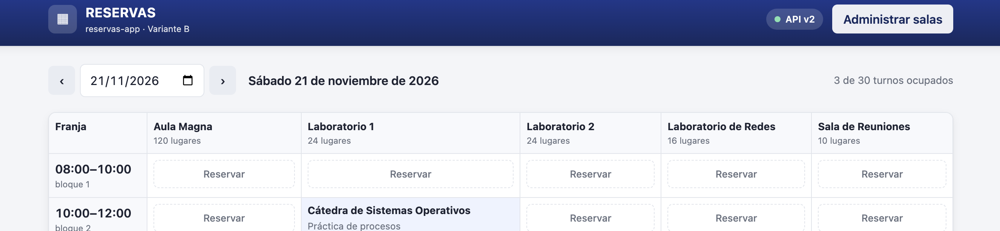
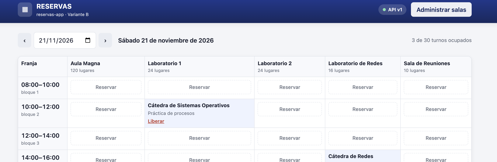

# reservas-app

## Arquitectura

    navegador ──► reservas-frontend ──────► reservas-api ──────► reservas-db
                  React + Vite             Node 20 + Express     MySQL 8.4
                  nginx :8080              :3000                 :3306
                  (host 3000)              (host 3001, solo      (sin puerto
                                            depuración)           publicado)

| Capa | Imagen | Puerto interno | Puerto publicado |
| --- | --- | --- | --- |
| `reservas-frontend` | React + Vite servido por nginx | 8080 | 3000 |
| `reservas-api` | Node 20 + Express | 3000 | 3001 (solo depuración) |
| `reservas-db` | MySQL 8.4 | 3306 | — |

El frontend es el único punto de entrada: nadie le habla a la base
directamente, y a la API le habla el frontend.

## Medición de imágenes (TP 2)

| Imagen                  | Base                              | Tamaño   | Reducción |
|-------------------------|-----------------------------------|----------|-----------|
| reservas-api:naive      | node:20                           | 1.59 GB  | —         |
| reservas-api:v1         | node:20-slim (multi-stage)        | 324 MB   | ~80%      |
| reservas-frontend:v1    | nginx-unprivileged:1.27-alpine    | 76.2 MB  | ~95% *    |

### Qué aportó cada decisión

- **Base mínima (node:20 → node:20-slim):** es la palanca que más pesa.
  La base completa arrastra ~1 GB de compiladores que en runtime no se usan.
- **Multi-stage (API):** la etapa `deps` instala con todo el toolchain y la
  etapa final solo copia `node_modules`; el andamiaje de instalación no queda
  en la imagen publicada.
- **Multi-stage (frontend):** la etapa Node compila el SPA y la etapa final
  (nginx) recibe solo `dist/`. En la imagen final no hay Node, ni npm, ni
  node_modules, ni código fuente. Verificado con `node --version` → not found.
- **.dockerignore:** no reduce el tamaño de la imagen, sino el del contexto de
  build (bajó a ~289 B); evita que node_modules local viaje al daemon y pise
  el instalado con binarios de otro sistema operativo.
- **npm ci --omit=dev (API):** instalación reproducible desde el lock, sin las
  dependencias de desarrollo, que en el backend no se usan en runtime.
- **Usuario no-root:** la API usa `USER node`; el frontend hereda el uid 101 de
  nginx-unprivileged. Defensa en profundidad: limita el daño ante un escape.
- **ARG + ENV APP_VERSION:** hornea la versión dentro de la imagen para que sea observable en runtime
- **Configuración al arrancar (frontend):** API_HOST/API_PORT + envsubst
  resuelven el backend en runtime, no en el build.


### Efecto del cache de construcción

Al modificar solo el código (server.js), la capa `RUN npm ci` sale del
cache (CACHED) y no reinstala dependencias: el `COPY . .` está por debajo
de la instalación, así que un cambio de código no la invalida.

Al modificar el manifiesto (package.json / package-lock.json), la capa de
instalación se reconstruye, porque el `COPY package.json package-lock.json`
está por encima del `npm ci`. Docker reutiliza una capa solo si su
instrucción y su entrada no cambiaron; al cambiar la entrada del COPY del
manifiesto, esa capa y todas las de arriba se rehacen (invalidación en
cascada). Por eso el manifiesto va arriba y el código abajo.
## docker history reservas-api:v1

La capa que más aporta es la instalación de Node (NODE_VERSION=20.20.2),
~126 MB, seguida de la base Debian bookworm, ~108 MB. Ambas forman la base
node:20-slim: juntas ~234 MB de los ~324 MB totales.

En contraste, el código (COPY . .) pesa 81.9 kB y las dependencias
(node_modules: express, mysql2) 9.85 MB. ~97% del tamaño es la base.

Conclusión: tras el multi-stage, que ya quita el toolchain de instalación,
el peso restante es el runtime de Node. Reducir más exigiría una base aún
más chica (alpine), con las advertencias de compatibilidad musl.

## Versión horneada (ARG + ENV)

    docker build -t reservas-api:v1 ./backend
    docker build --build-arg APP_VERSION=v2 -t reservas-api:v2 ./backend
    docker run --rm --entrypoint sh reservas-api:v2 -c 'echo $APP_VERSION'  # imprime v2

Si la v2 imprimiera v1, faltaría ENV APP_VERSION=${APP_VERSION}: el ARG no
sobrevive al build. Sin esto, el rolling update de la semana 6 no mostraría
cambio observable.

## Frontend: verificación (consigna 7)

    docker run --rm reservas-frontend:v1 whoami         # nginx (no root)
    docker run --rm reservas-frontend:v1 node --version # DEBE fallar: node not found
    docker images reservas-frontend                      # 76.2 MB

NGINX_ENVSUBST_FILTER=^API_ no es opcional: sin él, envsubst vaciaría las
variables propias de nginx ($uri, $host, $proxy_add_x_forwarded_for) y
generaría una config inválida en silencio. El filtro limita la sustitución
a las variables API_*, que se resuelven al arrancar (una imagen, todos los
entornos).

## Publicación en Docker Hub

    docker login
    docker tag reservas-api:v1       fvelardes/reservas-api:v1
    docker tag reservas-frontend:v1  fvelardes/reservas-frontend:v1
    docker push fvelardes/reservas-api:v1
    docker push fvelardes/reservas-frontend:v1

Publicadas:
- docker.io/fvelardes/reservas-api:v1
- docker.io/fvelardes/reservas-frontend:v1


##TP3-SEMANA 03
## 1. Red y volumen

Se crean los dos objetos de Docker con ciclo de vida propio, independientes
del contenedor: la red (para que las capas se encuentren por nombre) y el
volumen (para que los datos de la base sobrevivan).

### Comandos

    docker network create reservas-net
    docker volume create reservas-db-data

### Verificación

`docker network ls` — reservas-net creada con driver bridge (custom, con DNS interno):

    NETWORK ID     NAME           DRIVER    SCOPE
    5ed0ff35f535   bridge         bridge    local
    b4292581e1f8   host           host      local
    0c0e3cc69e52   none           null      local
    f60e97cdcea2   reservas-net   bridge    local

`docker volume ls` — reservas-db-data creado con driver local:

    DRIVER    VOLUME NAME
    local     reservas-db-data

La red usa el driver bridge en su variante custom (creada a mano), que a
diferencia de la red bridge por defecto incluye un servidor DNS interno capaz
de resolver los nombres de los contenedores conectados.
## 2. Base de datos (reservas-db)

MySQL 8.4 en la red reservas-net, con el volumen nombrado montado sobre su
directorio de datos, y SIN publicar ningún puerto.

### Comando

    docker run -d --name reservas-db --network reservas-net \
      -e MYSQL_DATABASE=reservasdb \
      -e MYSQL_USER=reservas_user \
      -e MYSQL_PASSWORD=reservas_pass \
      -e MYSQL_ROOT_PASSWORD=reservas_root_pass \
      -v reservas-db-data:/var/lib/mysql \
      mysql:8.4

### Por qué no se publica puerto (-p)

La base de datos es la capa más interna de la aplicación. No debe ser
accesible desde el anfitrión ni desde fuera de la máquina: solo los
contenedores conectados a reservas-net deben poder alcanzarla, resolviéndola
por su nombre (reservas-db) a través del DNS interno de la red. Publicar el
3306 al host abriría la base al exterior sin necesidad. Por eso se omite -p
de forma deliberada.

### Verificación

docker ps — el contenedor está Up y PORTS muestra 3306/tcp sin mapeo al host,
confirmando que el puerto está expuesto solo dentro de la red:

    CONTAINER ID   IMAGE       STATUS         PORTS                 NAMES
    5c062add2a17   mysql:8.4   Up 5 seconds   3306/tcp, 33060/tcp   reservas-db

En la primera inicialización, el log muestra dos veces "ready for connections":
el primero con port: 0 corresponde a un servidor temporal que MySQL usa para
inicializar el datadir y aplicar las variables MYSQL_* (crear la base, el
usuario y sus permisos); el definitivo informa port: 3306 y es el que acepta
conexiones. La base solo está lista cuando aparece este último.


## 3. API (reservas-api)

API Express en la red reservas-net, configurada para alcanzar la base por
nombre mediante DB_HOST=reservas-db. Publica su puerto en el 3001 del host
solo para depuración.

### Comando

    docker run -d --name reservas-api --network reservas-net -p 3001:3000 \
      -e PORT=3000 \
      -e DB_HOST=reservas-db \
      -e DB_PORT=3306 \
      -e DB_NAME=reservasdb \
      -e DB_USER=reservas_user \
      -e DB_PASSWORD=reservas_pass \
      -e APP_VERSION=v1 \
      -e SEED_DEMO=true \
      reservas-api:v1

### Comprobaciones

a) Resolución de nombre por el DNS interno de la red:

    $ docker exec reservas-api getent hosts reservas-db
    172.18.0.2      reservas-db

El nombre reservas-db se resuelve a la IP del contenedor de la base. En la red
bridge por defecto esta resolución no funcionaría (no tiene DNS por nombre).

b) Estado de la API y de su conexión a la base:

    $ curl -s localhost:3001/health
    {"status":"ok","db":"ok","version":"v1"}

"db":"ok" confirma que la API se conectó a MySQL a través del nombre reservas-db.

c) Tablas creadas por la siembra de datos (SEED_DEMO=true):

    $ docker exec reservas-db mysql -ureservas_user -preservas_pass reservasdb -e 'SHOW TABLES;'
    Tables_in_reservasdb
    reservas
    salas


## 4. Error deliberado: frontend fuera de la red

Se ejecuta el frontend OMITIENDO --network, para reproducir a propósito el
error que vuelve a aparecer (con otro disfraz) en las semanas 4, 5 y 6.

### Comando (sin --network, de forma deliberada)

    docker run -d --name reservas-frontend -p 3000:8080 \
      -e API_HOST=reservas-api -e API_PORT=3000 \
      reservas-frontend:v1

### Resultado

docker ps -a — el contenedor termina con Exited (1):

    CONTAINER ID   IMAGE                  STATUS                     NAMES
    7cc2cdd27c36   reservas-frontend:v1   Exited (1) 5 seconds ago   reservas-frontend

Mensaje textual del log (docker logs reservas-frontend):

    nginx: [emerg] host not found in upstream "reservas-api" in /etc/nginx/conf.d/default.conf:24

### Por qué el proceso termina en lugar de arrancar degradado

nginx resuelve el nombre del upstream (reservas-api) del proxy_pass UNA SOLA
VEZ, al iniciar. Al faltar --network reservas-net, el contenedor quedó en la
red bridge por defecto, que no tiene DNS por nombre, de modo que reservas-api
no resuelve. nginx no reintenta: levanta un error [emerg] y mata el proceso, y
como nginx es el proceso principal del contenedor, este muere con Exited (1).
Reiniciarlo sin conectarlo a la red daría el mismo resultado.


## 5. Frontend recreado en la red + verificación en el navegador

Se elimina el contenedor que quedó en Exited y se vuelve a crear con las MISMAS
opciones, agregando solo --network reservas-net. La imagen es la misma; no se
reconstruye nada. Lo único que cambia es la red.

### Comando

    docker rm -f reservas-frontend
    docker run -d --name reservas-frontend --network reservas-net -p 3000:8080 \
      -e API_HOST=reservas-api -e API_PORT=3000 \
      reservas-frontend:v1

Esta vez nginx resuelve reservas-api por DNS al arrancar y el contenedor queda Up.

### Verificación en el navegador (pestaña Network)

Al reservar una sala en http://localhost:3000, el pedido observado es:

    Request URL:    http://localhost:3000/api/reservas
    Request Method: POST
    Status Code:    201 Created
    Remote Address: [::1]:3000

El pedido se dirige al MISMO origen que sirvió la página (localhost:3000), no a
localhost:3001. No aparece ninguna solicitud OPTIONS: al no haber cruce de
origen, el navegador no realiza preflight de CORS. nginx recibe el pedido en
/api/reservas y lo reenvía internamente a reservas-api:3000; el navegador nunca
habla con la API directamente.


## 6. El proxy elimina el prefijo /api

Se comprueba que la ruta directa a la API y la ruta a través del proxy del
frontend devuelven el mismo contenido.

### Comandos y salida

a) Directo contra la API (puerto de depuración):

    $ curl -s localhost:3001/salas
    [{"id":4,"nombre":"Aula Magna",...},{"id":1,"nombre":"Laboratorio 1",...}, ...]

b) A través del proxy del frontend (con prefijo /api):

    $ curl -s localhost:3000/api/salas
    [{"id":4,"nombre":"Aula Magna",...},{"id":1,"nombre":"Laboratorio 1",...}, ...]

Ambas respuestas son idénticas. nginx recibe /api/salas y, gracias a la barra
final del proxy_pass (http://${API_HOST}:${API_PORT}/;), reenvía /salas a la
API quitando el prefijo /api. Si faltara esa barra, Express recibiría
/api/salas —ruta que no conoce— y devolvería 404.


## 7. Persistencia del dato

Se destruye el contenedor de la base y se vuelve a crear con las mismas
opciones del punto 2 (mismo volumen). Los datos deben sobrevivir.

### Pasos

    docker rm -f reservas-db
    docker volume ls            # reservas-db-data sigue existiendo
    docker run -d --name reservas-db --network reservas-net \
      -e MYSQL_DATABASE=reservasdb -e MYSQL_USER=reservas_user \
      -e MYSQL_PASSWORD=reservas_pass -e MYSQL_ROOT_PASSWORD=reservas_root_pass \
      -v reservas-db-data:/var/lib/mysql mysql:8.4
    docker restart reservas-api

### Verificación

    docker exec reservas-db mysql -ureservas_user -preservas_pass reservasdb \
      -e 'SELECT id, fecha, franja, responsable, creada_en FROM reservas;'

La reserva creada desde el navegador en el punto 5 (id 7, "Carlos Albaca",
creada_en 2026-10-11 23:41:12) continúa presente con su marca de tiempo
original, pese a haberse destruido y recreado el contenedor de la base. Esto
prueba que los datos viven en el volumen reservas-db-data, no en el contenedor:
el volumen tiene ciclo de vida propio y sobrevive a docker rm.

Nota: la API conservaba la conexión al contenedor anterior (otra IP) y requirió
docker restart para reconectar. Esta limitación se resuelve en la semana 4 con
depends_on y condition: service_healthy.


## 8. Orden de arranque

La aplicación debe levantarse en este orden, porque cada pieza depende de que
la anterior ya exista:

    red → volumen → base → API → frontend

### Qué falla al invertir cada paso

1. Red primero: sin reservas-net creada, los contenedores no tienen DNS por
   nombre. Un contenedor levantado sin --network cae en la red bridge por
   defecto y no resuelve a los demás por nombre (ver punto 4).

2. Volumen antes que la base: la base monta reservas-db-data para persistir sus
   datos. Debe existir antes de crear el contenedor de la base.

3. Base antes que la API: si la API arranca antes de que MySQL acepte
   conexiones, obtiene ECONNREFUSED. No es fatal: la API reintenta la conexión
   (se observaron 15 reintentos) hasta que la base está lista.

4. API antes que el frontend: este es el punto crítico. nginx resuelve el
   nombre del upstream (reservas-api) UNA SOLA VEZ, al arrancar. Si la API no
   existe todavía, nginx falla con [emerg] host not found in upstream y el
   contenedor muere con Exited (1). A diferencia de la API, nginx NO reintenta.

### Asimetría entre los dos fallos

- Base ↔ API: fallo tolerable. La API reintenta y se recupera sola.
- API ↔ Frontend: fallo fatal. nginx muere y no vuelve por sí mismo.

Esta diferencia explica por qué el orden API → frontend no admite inversión.

### Limitación actual

Este orden reside hoy en la memoria de quien levanta la aplicación y en una
secuencia de comandos docker run ejecutados a mano: no está declarado en ningún
archivo ejecutable. Nada impide levantarlos en el orden equivocado. Esta
limitación se resuelve en la semana 4 con Docker Compose, que declara las
dependencias con depends_on y condition: service_healthy, y levanta todo el
stack en el orden correcto con un solo comando.


# Semana 04 
---

## 1. Red y volumen reproducidos de la semana 3

El `docker-compose.yml` declara la red `reservas-net` y el volumen `reservas-db-data`,
ambos con `name:` explícito. El `name:` evita que Compose les anteponga el prefijo del
proyecto (`reservas-app_`): así son **exactamente** la red y el volumen de la semana 3,
con los datos adentro.

Antes del primer `docker compose up` se eliminaron los contenedores y la red de la
semana 3:

```bash
docker rm -f reservas-db reservas-api reservas-frontend
docker network rm reservas-net
```

**Por qué se borra la red pero no el volumen.** La red de la semana 3 fue creada a mano
(`docker network create`), sin la etiqueta de propiedad de Compose. Al encontrarla,
Compose falla (versiones 2.x: `network reservas-net was found but has incorrect label`)
o advierte y la reutiliza (versiones nuevas: `a network with name reservas-net exists
but was not created by compose`). Eliminarla deja la red a cargo de Compose, que la
recrea como suya. El **volumen** no se toca: contiene los datos, y Compose lo reutiliza
conservándolos (solo advierte: `volume ... already exists but was not created by
Docker Compose`).

La base de datos se declara **sin `ports`**: es la capa más interna y solo debe
alcanzarse desde `reservas-net`. En `docker compose ps` aparece como `3306/tcp` **sin
flecha** (expuesta en la red, no publicada en el host).

---

## 2. Healthcheck de reservas-db (MySQL)

```yaml
healthcheck:
  test:
    - CMD-SHELL
    - mysqladmin ping -h 127.0.0.1 -u root -p"$$MYSQL_ROOT_PASSWORD" --silent
  interval: 5s
  timeout: 5s
  retries: 20
  start_period: 40s
```

**a) Por qué `$$` y no `$`.** Con un solo `$`, la interpolación la hace **Compose** al
leer el archivo, y la contraseña queda escrita en texto plano en la línea de comando del
healthcheck, visible con `docker inspect`. Con `$$`, Compose escribe un `$` literal y la
variable la expande el intérprete **dentro del contenedor**, al ejecutar el healthcheck.
La contraseña nunca queda grabada en el comando. (Además, con un solo `$` la variable
—que existe dentro del contenedor, no a nivel Compose— llega vacía y `mysqladmin` falla
por contraseña, dejando la base `unhealthy`.)

**b) Por qué `start_period: 40s`.** La primera inicialización del directorio de datos de
MySQL es lenta (crea el datadir, la base, el usuario, apaga el servidor temporal y
levanta el definitivo). `start_period` es un período de gracia en el que los fallos no
cuentan: sin él, el contenedor quedaría marcado `unhealthy` cuando en realidad estaba
arrancando normalmente.

**c) Por qué `-h 127.0.0.1` y no `-h localhost`.** MySQL inicializa en dos tiempos:
primero un servidor **temporal** sin red, que solo atiende por *socket*; recién después
el servidor definitivo, que atiende por TCP. Con `-h localhost` el cliente se conecta por
socket, el servidor temporal responde y el healthcheck informa `healthy` durante la
inicialización, cuando la base aún no está disponible para nadie. Con `-h 127.0.0.1` la
conexión es por TCP, que el temporal no atiende: el ping recién responde con el servidor
definitivo, cuando la base y el usuario ya existen. `127.0.0.1` se refiere al propio
contenedor (loopback), porque el healthcheck corre dentro de la base.

*Síntoma de diagnóstico:* si la API registra `ECONNREFUSED` con la base ya en `healthy`,
el healthcheck está usando `-h localhost`.

---

## 3. Healthcheck de reservas-api (Node) — sin instalar curl

```yaml
healthcheck:
  test:
    - CMD
    - node
    - -e
    - "fetch('http://127.0.0.1:3000/health').then(r => process.exit(r.ok ? 0 : 1)).catch(() => process.exit(1))"
```

**Por qué no se instala curl.** Node incluye `fetch` nativo desde la versión 18, así que
el healthcheck se resuelve con el runtime que ya está en la imagen. Instalar `curl` solo
para chequear engordaría la imagen y le sumaría superficie de ataque, en contra de la
lección de tamaño de la semana 2. El script distingue dos fallas: `.then(r.ok?0:1)`
cubre "la API respondió, pero con error" (exit 1), y `.catch` cubre "no se pudo conectar"
(exit 1). Solo un 2xx da exit 0.

---

## 4. Healthcheck de reservas-frontend (nginx)

```yaml
healthcheck:
  test:
    - CMD-SHELL
    - wget -q -O - http://127.0.0.1:8080/healthz || exit 1
```

Usa `wget`, incluido en BusyBox y ya presente en Alpine (no se instala nada). Chequea
`/healthz` —una ruta del propio nginx— y **no** `/api/health`: cada healthcheck mide su
propia capa. Si midiera la API, la salud del frontend dependería de la de la API.

---

## 5. depends_on con condición — los dos casos no son equivalentes

```yaml
# en reservas-api
depends_on:
  reservas-db:
    condition: service_healthy

# en reservas-frontend
depends_on:
  reservas-api:
    condition: service_healthy
```

**a) reservas-api → reservas-db.** La API debe **conectarse** a la base, y la primera
inicialización de MySQL demora. La forma corta (`depends_on: [reservas-db]`) solo espera
a que el contenedor *arranque*, no a que la base esté *lista*: la API intentaría
conectarse al servidor temporal (que no atiende TCP) y fallaría con `ECONNREFUSED`. Por
eso necesita `service_healthy`. La API además reintenta la conexión ~60 s, que es lo
único que subsistirá en Kubernetes, donde no existe `depends_on`.

**b) reservas-frontend → reservas-api.** Lo que no puede faltar es **algún**
`depends_on`: sin él, el frontend arranca antes que la API, nginx no resuelve el upstream
y termina con `host not found in upstream`. A nginx le basta con que el nombre resuelva
—la forma corta también funcionaría—; se usa `service_healthy` además para que arranque
con la API ya en funcionamiento, sin respuestas 502 en los primeros segundos.

---

## 6. Validación y arranque

```bash
docker compose config        # valida y muestra la versión resuelta (siempre antes del up)
docker compose up --build -d # construye y arranca en orden, esperando cada healthcheck
docker compose ps            # estado y salud de cada servicio
docker compose logs -f reservas-api
```

Los tres servicios alcanzan `Up (healthy)`. El arranque es escalonado (db → api →
frontend), cada uno espera a que el anterior esté `healthy`. Los logs de la API confirman
la conexión: `esquema listo`, `datos de demo sembrados`, `escuchando en :3000`.

---

## 7. Ciclo de vida de los datos: down vs down -v

```bash
docker compose down     # elimina contenedores y red; CONSERVA el volumen
docker compose up -d
curl -s localhost:3000/api/reservas   # las reservas anteriores siguen respondiendo
docker compose down -v  # elimina además el volumen: BORRA los datos
```

- `docker compose down` elimina lo que el próximo `up` recrea idéntico (contenedores,
  red). El volumen `reservas-db-data` **sobrevive**: tras `down` + `up`, el `curl`
  devolvió reservas creadas días atrás, prueba de la persistencia.
- `docker compose down -v` elimina también el volumen (`Volume reservas-db-data
  Removed`). Los datos se pierden de forma **irreversible**; sirve para empezar de cero a
  propósito, y para nada más.

Como MySQL solo inicializa sobre un volumen vacío, tras `down` el `up` no reinicializa (los
datos están); tras `down -v` el `up` reinicializa desde cero y quedan solo los datos de
demo que siembra el código.

---

## 8. Variables sensibles: .env, .env.example y .gitignore

- `.env.example` (versionado) documenta el contrato de variables de las tres capas.
- `.env` (en `.gitignore`) tiene los valores reales y **no** viaja a git.
- Las dos contraseñas del usuario de la app deben coincidir entre capas
  (`MYSQL_PASSWORD` de la base = `DB_PASSWORD` de la API); la de root
  (`MYSQL_ROOT_PASSWORD`) solo la usa la base y su healthcheck.

**Qué sigue siendo un problema en producción.** El `.env` saca la contraseña de **git**,
pero no del **contenedor**: `docker compose config` y `docker inspect` la siguen mostrando
en texto plano, y cualquiera con acceso al host la ve. Es higiene de repositorio, no
gestión de secretos. La solución real llega en la semana 7 con los objetos **Secret**
(valores sensibles, gestionados aparte) y **ConfigMap** (configuración no sensible) de
Kubernetes.

---


##9d Escaneo de vulnerabilidades (Trivy)

Escaneo ejecutado como contenedor, sin instalar nada:

    docker run --rm -v /var/run/docker.sock:/var/run/docker.sock aquasec/trivy image reservas-api:v1
    docker run --rm -v /var/run/docker.sock:/var/run/docker.sock aquasec/trivy image reservas-frontend:v1

Las vulnerabilidades con parche se contaron con el flag `--ignore-unfixed`.

| Imagen | Origen | Hallazgos totales | Con parche (Fixed Version) |
|---|---|---|---|
| `reservas-api:v1` | sistema base (Debian 12.13) | 289 (6 critical, 68 high) | 61 (5 critical) |
| `reservas-api:v1` | dependencias Node | 40 (2 critical, 22 high) | 39 (2 critical) |
| `reservas-frontend:v1` | sistema base (Alpine 3.21.3) | 200 (2 critical, 51 high) | 200 (todas) |

**Lectura:**
- **Frontend (Alpine):** las 200 tienen parche → la base fijada quedó vieja. Se arregla reconstruyendo sobre una imagen base más nueva.
- **Base de la API (Debian):** solo 61 de 289 tienen parche; las ~228 restantes no tienen corrección disponible hoy. Las 61 accionables (5 critical) se mitigan actualizando la base; el resto se documenta y se decide.
- **Dependencias Node:** 39 de 40 tienen parche → se corrigen actualizando las librerías de la app (regenerar `package-lock.json`).

## 10. Mínimo privilegio (cap_drop / cap_add)

Se aplicó `cap_drop: [ALL]` a los tres servicios. Las dos imágenes propias
(`reservas-api`, `reservas-frontend`) siguieron en `healthy`: ya corren como
usuario no-root (`node` uid 1000 y `nginx` uid 101), no hacen operaciones
privilegiadas y no necesitan ninguna capability.

`reservas-db` falló al arrancar:

    [ERROR] [MY-010126] [Server] setgid: Operation not permitted
    [ERROR] [MY-010119] [Server] Aborting

La imagen de MySQL arranca como root para preparar el directorio de datos
(`/var/lib/mysql`) y luego baja a su propio usuario `mysql`. Ese cambio de
usuario/grupo y el ajuste de permisos requieren capabilities que `cap_drop: [ALL]`
había quitado. Se devolvieron solo las necesarias:

    reservas-db:
      cap_drop: [ALL]
      cap_add: [CHOWN, SETGID, SETUID, DAC_OVERRIDE, FOWNER]

- CHOWN: cambiar el dueño de archivos del datadir
- SETGID / SETUID: cambiar de grupo/usuario (bajar de root a mysql) — SETGID es la
  que el error señalaba
- DAC_OVERRIDE / FOWNER: ajustar permisos y operar sobre archivos del datadir

Con ese `cap_add`, la base alcanzó `healthy` y la cadena completa volvió a levantar.

**Por qué la base requiere capabilities y las otras dos no:** la base *elige*
arrancar como root para inicializarse y luego degradar a un usuario sin privilegios;
ese procedimiento necesita permisos concretos. Las imágenes propias ya son no-root
desde el arranque, así que no tienen nada que degradar ni ningún permiso privilegiado
que ejercer.

`privileged: true` no se usa nunca para una aplicación: otorga *todas* las
capabilities y el host entero, cuando la base solo necesita cinco específicas. El
principio es el opuesto: sacar todo y devolver únicamente lo justo.


######################
## 11. Comparación: docker-compose.yml vs los tres `docker run` de la semana 3

En la semana 3, levantar el proyecto requería crear la red y el volumen a mano y
después ejecutar tres `docker run` largos, en un orden que había que recordar y con
una espera manual entre la base y la API:

    docker network create reservas-net
    docker volume create reservas-db-data

    docker run -d --name reservas-db --network reservas-net \
      -e MYSQL_DATABASE=reservasdb -e MYSQL_USER=reservas_user \
      -e MYSQL_PASSWORD=reservas_pass -e MYSQL_ROOT_PASSWORD=reservas_root_pass \
      -v reservas-db-data:/var/lib/mysql mysql:8.4
    # (esperar a mano el mensaje "ready for connections" con port: 3306)
    docker run -d --name reservas-api --network reservas-net \
      -e DB_HOST=reservas-db -e DB_PORT=3306 -e DB_NAME=reservasdb \
      -e DB_USER=reservas_user -e DB_PASSWORD=reservas_pass \
      -p 3001:3000 reservas-api:v1
    docker run -d --name reservas-frontend --network reservas-net \
      -p 3000:8080 reservas-frontend:v1

Hoy todo eso es un único `docker-compose.yml` versionado y un `docker compose up`.

### Qué desapareció

- **Los comandos manuales.** Cuatro comandos (`network create`, `volume create` y
  tres `run`) con sus flags se reemplazan por un archivo y un `up`.
- **El orden en la memoria.** El orden red → volumen → base → API → frontend ya no
  reside en la cabeza de quien levanta el proyecto: lo declara `depends_on` y lo
  resuelve Compose.
- **La espera manual.** Ya no hace falta mirar los logs y esperar el `ready for
  connections` antes de lanzar la API: los `healthcheck` + `condition:
  service_healthy` hacen que cada servicio espere a que el anterior esté sano.
- **Los flags sueltos.** Cada `-e`, `-p`, `-v`, `--network`, `--name` pasa a ser una
  clave declarada en el archivo.

### Qué apareció

- **Un archivo versionado**, que vive en el repositorio junto al código y es la fuente
  única de verdad de cómo se levanta el proyecto.
- **Los healthchecks**: cada servicio declara qué significa estar sano (`mysqladmin
  ping`, `node fetch`, `wget`). Antes un contenedor solo estaba `Up` o no; no había
  noción de salud.
- **`depends_on` con condición**: el orden y la espera, antes implícitos, ahora son
  declaración explícita.
- **Un solo comando para todo el ciclo**: `up`, `down`, `logs`, `ps`, `config` operan
  sobre el proyecto entero.

### Mapa de traducción

| Semana 3 (`docker run`) | Semana 4 (`docker-compose.yml`) |
|---|---|
| `--name reservas-db` | nombre del servicio (`reservas-db:`) |
| `--network reservas-net` | `networks: [reservas-net]` + bloque `networks:` |
| `-v reservas-db-data:/var/lib/mysql` | `volumes: [...]` + bloque `volumes:` |
| `-e VAR=valor` | `environment:` |
| `-p 3001:3000` | `ports: ["3001:3000"]` |
| el orden en que se tipean los comandos | `depends_on:` + `healthcheck:` |

La última fila es la única que no es una traducción literal: el orden de los comandos
no era un flag, era **memoria**. Ahora es una declaración, y es la ganancia central de
esta etapa.

### Hacia adelante

Este archivo es la referencia contra la que se compararán los manifiestos de Kubernetes
desde la semana 5: cada servicio se vuelve un manifiesto, y `depends_on` desaparece
(Kubernetes no lo tiene). Por eso la API conserva su reintento de conexión (~60 s), que
es lo único de la espera que sobrevive al cambio de orquestador.
########################################


# Semana 05 — Kubernetes

## Consigna 1 — Imágenes propias en el registry y error de pull deliberado

### Imágenes publicadas

Las imágenes de la aplicación están publicadas en Docker Hub, bajo el usuario `fvelardes`:

- `fvelardes/reservas-api:v1`
- `fvelardes/reservas-frontend:v1`

La base de datos usa la imagen oficial `mysql:8.4`, que ya reside en Docker Hub y no requiere publicación propia.

En los manifiestos, las imágenes propias se nombran de forma **completa** (`fvelardes/<imagen>:<tag>`), porque el clúster corre en otra máquina con su propio `containerd` y no comparte la caché de imágenes del Docker local.

### Error deliberado: `ImagePullBackOff`

Se creó un Pod nombrando la imagen **sin el usuario del registry** (`reservas-api:v1` en lugar de `fvelardes/reservas-api:v1`), para provocar el fallo:

```bash
kubectl run reservas-api --image=reservas-api:v1 -n reservas-app
```

Estado resultante:

```
NAME           READY   STATUS             RESTARTS   AGE
reservas-api   0/1     ImagePullBackOff   0          30s
```

Salida de `kubectl describe pod reservas-api -n reservas-app` (sección relevante):

```
Containers:
  reservas-api:
    Image:          reservas-api:v1
    State:          Waiting
      Reason:       ImagePullBackOff
    Ready:          False
    Restart Count:  0

Events:
  Type     Reason     Age                   From               Message
  ----     ------     ----                  ----               -------
  Normal   Scheduled  3m38s                 default-scheduler  Successfully assigned reservas-app/reservas-api to fvelardes
  Normal   Pulling    36s (x5 over 3m28s)   kubelet            Pulling image "reservas-api:v1"
  Warning  Failed     35s (x5 over 3m24s)   kubelet            Failed to pull image "reservas-api:v1": failed to pull and unpack image "docker.io/library/reservas-api:v1": failed to resolve reference "docker.io/library/reservas-api:v1": pull access denied, repository does not exist or may require authorization: server message: insufficient_scope: authorization failed
  Warning  Failed     35s (x5 over 3m24s)   kubelet            Error: ErrImagePull
  Normal   BackOff    11s (x11 over 3m24s)  kubelet            Back-off pulling image "reservas-api:v1"
  Warning  Failed     11s (x11 over 3m24s)  kubelet            Error: ImagePullBackOff
```

### Diagnóstico

En la sección `Events` se observa que el kubelet intentó descargar la imagen **`docker.io/library/reservas-api:v1`**. Al nombrar la imagen sin el usuario del registry, Kubernetes la expandió al espacio de las imágenes oficiales de Docker Hub (`docker.io/library/...`). Como no existe ninguna imagen oficial con ese nombre, el pull falló y el Pod quedó en `ImagePullBackOff`.

El `Restart Count: 0` confirma que **nunca existió un contenedor**: la imagen no llegó a descargarse, por lo que no hubo proceso que arrancara ni que escribiera logs. Por eso la causa se diagnostica en los `Events` de `describe`, y no con `kubectl logs`.

---

## Consigna 2 — Namespace `reservas-app` y namespace por defecto del contexto

### Verificación previa del contexto

Antes de aplicar cualquier manifiesto se verifica contra qué clúster se está operando:

```bash
kubectl config current-context
```

```
fvelardes
```

Verificar el contexto antes de actuar es el hábito que evita intervenir sobre el clúster equivocado: en un entorno real conviven varios contextos (`dev`, `staging`, `producción`) en el mismo kubeconfig, y el riesgo principal es ejecutar en producción algo pensado para desarrollo.

### Creación del namespace

```bash
kubectl create namespace reservas-app
```

El namespace ya existía de un paso anterior, por lo que el comando confirma su presencia:

```
Error from server (AlreadyExists): namespaces "reservas-app" already exists
```

Listado de namespaces del clúster:

```
NAME              STATUS   AGE
default           Active   9d
kube-flannel      Active   9d
kube-node-lease   Active   9d
kube-public       Active   9d
kube-system       Active   9d
metallb-system    Active   9d
nginx-ingress     Active   9d
reservas-app      Active   23m
```

### Namespace por defecto del contexto

Para no repetir `-n reservas-app` en cada comando, se fija el namespace por defecto del contexto actual:

```bash
kubectl config set-context --current --namespace=reservas-app
```

```
Context "fvelardes" modified.
```

Comprobación de que quedó fijado:

```bash
kubectl config view --minify | grep namespace
```

```
    namespace: reservas-app
```

```bash
kubectl get pods
```

```
No resources found in reservas-app namespace.
```

El `kubectl get pods` sin flag `-n` consulta ahora directamente `reservas-app`, lo que confirma que el namespace por defecto quedó establecido. El resultado vacío indica además que el Pod del experimento de la consigna 1 fue eliminado y el namespace parte limpio.

---

## Consignas 3 y 4 — Los tres manifiestos y su aplicación en orden

### Generación del primer manifiesto (DB)

El manifiesto de la base de datos se generó con un comando imperativo en lugar de escribirlo a mano, y luego se editó para incorporar las cuatro variables `MYSQL_*` y el puerto 3306:

```bash
kubectl run reservas-db --image=mysql:8.4 --dry-run=client -o yaml > k8s/pod-reservas-db.yaml
```

`--dry-run=client` genera el YAML localmente sin crear nada en el clúster; `-o yaml` lo imprime y `>` lo guarda en el archivo. Es el puente del modo imperativo al declarativo.

Los otros dos manifiestos (`pod-reservas-api.yaml` y `pod-reservas-frontend.yaml`) se escribieron con las variables de entorno tomadas del `docker-compose.yml` de la semana anterior. Los tres archivos viven en `k8s/`.

Nota sobre `DB_HOST`: en el manifiesto de la API se conserva `DB_HOST=reservas-db` (el mismo valor del compose), **a sabiendas de que fallará**. En Kubernetes un Pod suelto no publica un nombre DNS resoluble; eso lo hace un Service, que aún no existe. El diagnóstico de ese fallo es la consigna 5.

### Aplicación en orden

```bash
kubectl apply -f k8s/pod-reservas-db.yaml
kubectl apply -f k8s/pod-reservas-api.yaml
kubectl apply -f k8s/pod-reservas-frontend.yaml
```

### Incidente: `ImagePullBackOff` por arquitectura de imagen

En el primer intento, `reservas-api` y `reservas-frontend` quedaron en `ImagePullBackOff`, mientras que `reservas-db` (imagen oficial `mysql:8.4`) arrancó sin problema. La sección `Events` de `kubectl describe pod reservas-api` mostró la causa:

```
Failed to pull image "fvelardes/reservas-api:v1": rpc error: code = NotFound
desc = failed to pull and unpack image "docker.io/fvelardes/reservas-api:v1":
no match for platform in manifest: not found
```

El mensaje `no match for platform in manifest` indica un desajuste de arquitectura: las imágenes se habían construido en un Mac Apple Silicon (`arm64`), mientras que el clúster corre sobre `amd64`. La imagen existía en el registry, pero sin una variante compatible con la plataforma del nodo. La imagen oficial `mysql:8.4` no falló porque es multiarquitectura e incluye la variante `amd64`.

**Diferencia con la consigna 1:** aquel `ImagePullBackOff` se debía a un nombre de imagen mal escrito (sin el usuario del registry); este, a una arquitectura incompatible. El estado es el mismo, la causa es distinta, y en ambos casos se diagnostica en los `Events` de `describe`.

Solución: reconstruir ambas imágenes para `linux/amd64` con `docker buildx` y volver a publicarlas:

```bash
docker buildx build --platform linux/amd64 -t fvelardes/reservas-api:v1 --push ./backend
docker buildx build --platform linux/amd64 -t fvelardes/reservas-frontend:v1 --push ./frontend
```

Luego se eliminaron y recrearon los Pods afectados para forzar un nuevo pull:

```bash
kubectl delete pod reservas-api reservas-frontend
kubectl apply -f k8s/pod-reservas-api.yaml
kubectl apply -f k8s/pod-reservas-frontend.yaml
```

### IPs registradas

Con las imágenes correctas, los tres Pods se crearon y recibieron dirección IP:

```
NAME                READY   STATUS             RESTARTS   IP            NODE
reservas-db         1/1     Running            0          10.244.0.7    fvelardes
reservas-api        0/1     CrashLoopBackOff   3          10.244.0.10   fvelardes
reservas-frontend   0/1     CrashLoopBackOff   5          10.244.0.11   fvelardes
```

| Pod | IP |
|-----|-----|
| `reservas-db` | `10.244.0.7` |
| `reservas-api` | `10.244.0.10` |
| `reservas-frontend` | `10.244.0.11` |

Resuelto el problema de las imágenes, `reservas-db` quedó `Running`, mientras que `reservas-api` y `reservas-frontend` pasaron a `CrashLoopBackOff`: ahora el contenedor **sí arranca** y luego muere (el `Restart Count` sube, a diferencia del `ImagePullBackOff`, donde nunca había contenedor). Ese fallo es el esperado y se diagnostica en las consignas siguientes.

---

## Consigna 5 — Diagnóstico del `CrashLoopBackOff` de la API

### Logs del contenedor anterior

```bash
kubectl logs reservas-api --previous
```

```
[2026-10-23T02:45:40.164Z] intento 1/15 de conexión falló: getaddrinfo ENOTFOUND reservas-db
[2026-10-23T02:45:44.171Z] intento 2/15 de conexión falló: getaddrinfo ENOTFOUND reservas-db
...
[2026-10-23T02:46:36.249Z] intento 15/15 de conexión falló: getaddrinfo ENOTFOUND reservas-db
[2026-10-23T02:46:36.250Z] no se pudo inicializar la base: getaddrinfo ENOTFOUND reservas-db
```

Se usa `--previous` porque el Pod está en pleno ciclo de reinicios: el contenedor actual puede no haber escrito aún, mientras que la encarnación anterior ya dejó registrado el error completo.

### Estado del Pod

```bash
kubectl describe pod reservas-api
```

```
Containers:
  reservas-api:
    Image:          fvelardes/reservas-api:v1
    Port:           3000/TCP
    State:          Terminated
      Reason:       Error
      Exit Code:    1
    Last State:     Terminated
      Reason:       Error
      Exit Code:    1
    Ready:          False
    Restart Count:  6
    Environment:
      DB_HOST:      reservas-db
      DB_USER:      reservas_user
      DB_PASSWORD:  reservas_pass
      DB_NAME:      reservasdb

Events:
  Normal   Pulled   ...        Container image "fvelardes/reservas-api:v1" already present on machine
  Normal   Created  (x7 ...)   Container created
  Normal   Started  (x7 ...)   Container started
  Warning  BackOff  (x9 ...)   Back-off restarting failed container reservas-api
```

El `Restart Count: 6` y los `Started (x7)` / `BackOff (x9)` confirman que el contenedor **arranca y muere repetidamente** (a diferencia del `ImagePullBackOff`, donde el contador queda en 0). La imagen se baja sin problemas; el fallo ocurre al ejecutarse la aplicación. Las variables de entorno están correctamente inyectadas: el problema no es su contenido sino que el valor `reservas-db` no es resoluble.

### Causa raíz

La API no puede resolver el nombre `reservas-db` — el error `getaddrinfo ENOTFOUND reservas-db` es un fallo de resolución DNS. En Kubernetes un Pod suelto **no publica un nombre DNS**: ningún componente registra `reservas-db` en CoreDNS. Eso es tarea de un **Service**, que en esta entrega deliberadamente no existe.

En dos líneas: `DB_HOST=reservas-db` no resuelve porque falta el Service que le daría a ese nombre una entrada DNS en el clúster; tras 15 intentos la aplicación termina con `Exit Code 1`, el kubelet la reinicia por `restartPolicy: Always`, y el ciclo se repite → `CrashLoopBackOff`. El mismo valor `reservas-db` funcionaba en Docker Compose porque allí el DNS embebido de la red resolvía los nombres de servicio automáticamente; en Kubernetes ese rol lo cumple un Service sobre CoreDNS.

---

## Consigna 6 — La API por dirección IP, y por qué no es una solución

### Experimento A — Reemplazar el nombre por la IP del Pod

Se reemplazó `DB_HOST: reservas-db` por la IP del Pod de la base de datos (`10.244.0.7`) en `pod-reservas-api.yaml`, y se recreó el Pod de la API:

```bash
kubectl delete pod reservas-api
kubectl apply -f k8s/pod-reservas-api.yaml
```

La API alcanzó el estado `Running` y se conectó correctamente:

```
[...] esquema listo en 10.244.0.7/reservasdb
[...] datos de demo sembrados (5 salas)
[...] reservas-api v1 escuchando en :3000
```

Una IP no necesita resolución DNS, por lo que la conexión funcionó donde el nombre había fallado.

### Experimento B — Recrear la base de datos

Se eliminó y recreó el Pod de la base con **el mismo manifiesto, sin cambios**:

```bash
kubectl delete pod reservas-db
kubectl apply -f k8s/pod-reservas-db.yaml
kubectl get pod reservas-db -o wide
```

```
NAME          READY   STATUS    RESTARTS   AGE   IP            NODE
reservas-db   1/1     Running   0          97s   10.244.0.13   fvelardes
```

La base recibió una **IP nueva** (`10.244.0.13`) distinta de la anterior (`10.244.0.7`). Mismo Pod, mismo manifiesto, dirección diferente: la IP no es una propiedad del Pod, se la asigna el clúster en cada creación.

La API, que seguía apuntando a `10.244.0.7`, volvió a fallar al recrearse:

```
[...] intento 1/15 de conexión falló: connect EHOSTUNREACH 10.244.0.7:3306
[...] intento 15/15 de conexión falló: connect EHOSTUNREACH 10.244.0.7:3306
[...] no se pudo inicializar la base: connect EHOSTUNREACH 10.244.0.7:3306
```

```
NAME           READY   STATUS   RESTARTS       AGE    IP            NODE
reservas-api   0/1     Error    1 (119s ago)   4m5s   10.244.0.14   fvelardes
```

### Diferencia entre los dos errores de conexión

| Consigna | `DB_HOST` | Error | Significado |
|----------|-----------|-------|-------------|
| 5 | `reservas-db` | `getaddrinfo ENOTFOUND` | El **nombre** no se resuelve (falla el DNS) |
| 6 | `10.244.0.7` | `connect EHOSTUNREACH` | La **IP** es válida pero no hay nada escuchando ahí |

En la consigna 5 ni siquiera se llegaba a intentar la conexión: faltaba traducir el nombre a una IP. En la consigna 6 la IP es una dirección concreta, pero quedó obsoleta cuando la base se mudó a otra, y el host resulta inalcanzable.

### Conclusión

La dirección IP de un Pod es **descartable**: al recrear el Pod, cambia. Configurar `DB_HOST` con la IP de un Pod funciona solo hasta el primer reinicio de la base; después apunta a una dirección muerta y la aplicación se rompe. En ese hecho reside la razón de existir de los **Services**: un Service provee un nombre y una IP virtual **estables**, que permanecen fijos aunque el Pod detrás se recree. Un apunte adicional observado: tras recrear la base, la API continuó unos instantes en `Running` apuntando a la IP vieja antes de reiniciarse y fallar — un recordatorio de que una configuración basada en IPs de Pod puede quedar inconsistente de forma silenciosa, sin un error inmediato.

### Restitución del nombre

Siguiendo la indicación del enunciado, se restituyó `DB_HOST: reservas-db` en el manifiesto y se recreó el Pod:

```bash
kubectl delete pod reservas-api
kubectl apply -f k8s/pod-reservas-api.yaml
```

El manifiesto queda **deliberadamente roto** (la API vuelve a `CrashLoopBackOff` con `ENOTFOUND`) hasta que, en la semana 6, un Service registre `reservas-db` en el DNS del clúster. Conservar la IP del Pod habría dejado la entrega en un estado que la clase siguiente contradice.

---

## Consigna 7 — Frontend: `host not found in upstream`

El Pod `reservas-frontend` quedó en `CrashLoopBackOff` desde que se aplicó su manifiesto. Los logs de la ejecución anterior muestran el motivo:

```bash
kubectl logs reservas-frontend --previous
```

```
/docker-entrypoint.sh: Launching /docker-entrypoint.d/20-envsubst-on-templates.sh
20-envsubst-on-templates.sh: Running envsubst on /etc/nginx/templates/default.conf.template to /etc/nginx/conf.d/default.conf
/docker-entrypoint.sh: Configuration complete; ready for start up
[emerg] 1#1: host not found in upstream "reservas-api" in /etc/nginx/conf.d/default.conf:24
nginx: [emerg] host not found in upstream "reservas-api" in /etc/nginx/conf.d/default.conf:24
```

La configuración se genera bien desde la plantilla (`Configuration complete`), pero al iniciar NGINX intenta resolver el upstream `reservas-api` de la línea 24 (`proxy_pass`) y aborta con nivel `[emerg]`.

```bash
kubectl describe pod reservas-frontend
```

```
State:          Waiting
  Reason:       CrashLoopBackOff
Last State:     Terminated
  Reason:       Error
  Exit Code:    1
  Started:      Sat, 24 Oct 2026 14:43:57 -0300
  Finished:     Sat, 24 Oct 2026 14:43:59 -0300
Restart Count:  457

Events:
  Normal   Pulled   (x457 over 39h)   Container image "fvelardes/reservas-frontend:v1" already present on machine
  Warning  BackOff  (x1990 over 39h)  Back-off restarting failed container reservas-frontend
```

Cada ejecución dura unos **2 segundos** (Started → Finished) y termina con `Exit Code 1`. A diferencia de la API, que reintenta 15 veces durante ~1 minuto antes de rendirse, NGINX no reintenta: si un upstream no resuelve al arrancar, se detiene de inmediato. En 39 horas acumuló 457 reinicios.

### Causa raíz

NGINX necesita resolver el nombre `reservas-api` al iniciar para configurar el `proxy_pass`, pero ningún Service publica ese nombre en el DNS del clúster; por eso aborta con `host not found in upstream`, termina con código 1 y el kubelet lo reinicia en loop (`CrashLoopBackOff`). Es el mismo síntoma de la semana 3 con otra causa: allí faltaba la red de Docker que proveía el nombre; aquí falta el Service.

---

## Consigna 8 — Acceso a la API con `port-forward`

Sin un Service, no existe forma de alcanzar la API desde fuera del clúster. `kubectl port-forward` abre un túnel desde la máquina local hasta un Pod concreto, pasando por la API de Kubernetes.

Como la API solo escucha en `:3000` después de conectarse a la base, para esta consigna se configuró **temporalmente** `DB_HOST` con la IP actual del Pod de la base (la misma técnica de la consigna 6) y luego se restituyó el nombre `reservas-db`.

Terminal 1 (queda bloqueada mientras el túnel existe):

```bash
kubectl port-forward pod/reservas-api 3001:3000
```

Terminal 2:

```bash
curl -s localhost:3001/health
```

```json
{"status":"ok","db":"ok","version":"v1"}
```

```bash
curl -s localhost:3001/reservas
```

```json
[{"id":1,"sala_id":1,"sala":"Laboratorio 1","fecha":"2026-10-24","franja":2,"responsable":"Cátedra de Sistemas Operativos","motivo":"Práctica de procesos","creada_en":"2026-10-24 18:07:09"},
 {"id":2,"sala_id":3,"sala":"Laboratorio de Redes","fecha":"2026-10-24","franja":4,"responsable":"Cátedra de Redes","motivo":"Laboratorio de routing","creada_en":"2026-10-24 18:07:10"},
 {"id":3,"sala_id":4,"sala":"Aula Magna","fecha":"2026-10-24","franja":5,"responsable":"Secretaría Académica","motivo":"Charla de egresados","creada_en":"2026-10-24 18:07:11"}]
```

`/health` confirma que la API está viva y conectada a la base (`"db":"ok"`); `/reservas` devuelve los datos de demo sembrados al iniciar.

### `port-forward` es depuración, no publicación

- **Depende de la terminal:** el túnel existe solo mientras el comando corre; con Ctrl-C se corta y la API deja de responder en `localhost:3001`.
- **Apunta a un Pod concreto:** si el Pod se reinicia o se recrea, el túnel se interrumpe y hay que volver a abrirlo.
- **Es individual:** solo da acceso a quien lo ejecuta, desde su máquina y con su kubeconfig. Ningún otro usuario ni componente del clúster puede usarlo.

Comprobación: tras cortar el túnel con Ctrl-C, el mismo pedido falla de inmediato:

```bash
curl localhost:3001/health
```

```
curl: (7) Failed to connect to localhost port 3001 after 0 ms: Couldn't connect to server
```

La API sigue corriendo en el clúster, pero ya no existe ningún camino desde la máquina local hasta ella.

Publicar la aplicación de forma estable (nombre fijo, independiente de los Pods, accesible para otros) es tarea de un **Service**, en la semana 6.

---

## Consigna 9 — Un Pod es mortal: nadie lo recrea

Estado previo (la API ya con `DB_HOST: reservas-db` restituido, fallando y reiniciándose dentro de su Pod):

```
NAME                READY   STATUS    RESTARTS          AGE
reservas-api        0/1     Error     3 (2m17s ago)     6m34s
reservas-db         1/1     Running   0                 39h
reservas-frontend   0/1     Error     467 (5m47s ago)   40h
```

Se eliminó el Pod de la API:

```bash
kubectl delete pod reservas-api
```

```
pod "reservas-api" deleted from reservas-app namespace
```

```bash
kubectl get pods
```

```
NAME                READY   STATUS    RESTARTS         AGE
reservas-db         1/1     Running   0                39h
reservas-frontend   0/1     Error     469 (6m7s ago)   40h
```

`reservas-api` **desapareció y no volvió**. Ningún componente del clúster lo recreó.

### Análisis

Hay dos niveles de "muerte", y el comportamiento es opuesto:

| Qué muere | Quién actúa | Resultado |
|-----------|-------------|-----------|
| El **contenedor** (crash, `Exit Code 1`) | El **kubelet**, por `restartPolicy: Always` | Se reinicia dentro del mismo Pod → `RESTARTS` sube, `CrashLoopBackOff` |
| El **Pod** (borrado, o falla del nodo) | **Nadie** | El Pod deja de existir y no se recrea |

`restartPolicy` reinicia contenedores dentro de un Pod que existe; si el Pod deja de existir, no queda nada sobre lo cual actuar. Lo que vigila y recrea Pods en Kubernetes es un **controller**, que compara el estado deseado ("debe haber 1 Pod de la API") con el real y corrige la diferencia. Un Pod suelto no tiene ningún controller por encima. Ese es el punto de partida de la semana 6: el **Deployment**.

Finalmente, el Pod se recreó a mano con el manifiesto restituido, para dejar la entrega en su estado correcto (API en `CrashLoopBackOff` con `ENOTFOUND` hasta que exista el Service):

```bash
kubectl apply -f k8s/pod-reservas-api.yaml
```

---

## Consigna 10 — Cheatsheet propio: los diez comandos que usé

Ordenados según el momento del TP en que aparecieron.

| # | Comando | Qué hace | Dónde lo usé |
|---|---------|----------|--------------|
| 1 | `kubectl config current-context` | Muestra contra qué clúster (y con qué usuario) va a hablar kubectl. Es lo primero que conviene mirar antes de aplicar nada. | Verificar la conexión por VPN con el kubeconfig |
| 2 | `kubectl create namespace reservas-app` | Crea un namespace: un espacio con nombre propio para agrupar y aislar los objetos del proyecto. | Consigna 2 |
| 3 | `kubectl config set-context --current --namespace=reservas-app` | Fija el namespace por defecto del contexto actual, para no tener que escribir `-n reservas-app` en cada comando. Queda guardado en el kubeconfig. | Consigna 2 |
| 4 | `kubectl run <pod> --image= --dry-run=client -o yaml > archivo.yaml` | No crea nada: genera el esqueleto YAML de un Pod para usarlo como punto de partida del manifiesto. | Consigna 3 (manifiesto de la DB) |
| 5 | `kubectl apply -f <archivo.yaml>` | Envía un manifiesto al clúster para que haga existir el estado que describe. Si el objeto ya existe y no cambió, no hace nada. | Crear los tres Pods; restituir la API |
| 6 | `kubectl get pods` (`-o wide`, `-w`) | Lista los Pods con su estado, reinicios y edad. `-o wide` agrega la IP y el nodo; `-w` se queda mirando los cambios en vivo. | En todas las consignas; IPs en la 4 y la 6 |
| 7 | `kubectl describe pod <pod>` | Muestra el detalle de un Pod: imagen, variables, estado del contenedor (`Exit Code`, `Restart Count`) y los **Events**. Es donde está la causa cuando nunca hubo contenedor. | `ImagePullBackOff` (1), `CrashLoopBackOff` (5, 7) |
| 8 | `kubectl logs <pod>` (`--previous`, `-f`) | Muestra lo que escribió la aplicación. `--previous` lee la ejecución anterior (la que murió); `-f` sigue el log en vivo. | `ENOTFOUND` (5), `EHOSTUNREACH` (6), `host not found in upstream` (7) |
| 9 | `kubectl delete pod <pod>` | Borra un Pod. Sin un controller encima, nadie lo recrea. También sirve para "aplicar" cambios en campos inmutables (como `env`): borrar y volver a aplicar. | Recrear la DB (6), probar que el Pod es mortal (9) |
| 10 | `kubectl port-forward pod/<pod> <local>:<pod>` | Abre un túnel desde mi máquina hasta un Pod concreto. Bloquea la terminal y se corta con Ctrl-C o si el Pod se reinicia: es para depurar, no para publicar. | Consigna 8 (`3001:3000` hacia la API) |

### Lo que aprendí a usar en conjunto

- **¿Qué pasa?** `get pods` → **¿por qué?** `describe` (si nunca hubo contenedor) o `logs --previous` (si hubo y murió).
- Un `get pods` vacío casi siempre significa que estoy mirando otro namespace: revisar el comando 3.

---

## Consigna 11 — `docker-compose.yml` vs los tres manifiestos

El `docker-compose.yml` de la semana 4 describe tres servicios en **un solo host**; los manifiestos de esta semana describen tres **Pods sueltos** en un clúster. Ambos son declarativos, pero el segundo todavía no tiene casi nada de lo que hacía funcionar al primero.

### Qué se conservó

| Elemento | Compose | Manifiestos |
|----------|---------|-------------|
| Nombres | servicios `reservas-db`, `reservas-api`, `reservas-frontend` | Pods con los mismos nombres |
| Imágenes | `mysql:8.4`, `reservas-api:v1`, `reservas-frontend:v1` | `mysql:8.4`, `fvelardes/reservas-api:v1`, `fvelardes/reservas-frontend:v1` |
| Variables de la DB | `MYSQL_ROOT_PASSWORD`, `MYSQL_DATABASE`, `MYSQL_USER`, `MYSQL_PASSWORD` | las mismas cuatro, en `env:` |
| Variables de la API | `DB_HOST: reservas-db`, `DB_USER`, `DB_PASSWORD`, `DB_NAME` | las mismas, con `DB_HOST: reservas-db` |
| Puertos de los contenedores | 3306, 3000, 8080 | `containerPort` 3306, 3000, 8080 |
| Upstream del frontend | `API_HOST=reservas-api`, `API_PORT=3000` (ENV del Dockerfile) | igual: el manifiesto no lo redefine y usa el valor horneado en la imagen |

La aplicación es la misma y espera exactamente los mismos nombres. Eso es lo que hace visible lo que falta: la configuración apunta a `reservas-db` y `reservas-api`, pero en el clúster nadie publica esos nombres.

### Qué desapareció

| Compose | Qué hacía | En los manifiestos |
|---------|-----------|--------------------|
| `build:` | construía la imagen en el host | no existe: el clúster no construye, descarga del registry (por eso el usuario `fvelardes/` y el `ImagePullBackOff` de la consigna 1) |
| `networks: reservas-net` | red propia con **DNS por nombre de servicio** | la red de Pods es plana y todos se alcanzan por IP, pero **un Pod no registra un nombre DNS** → `ENOTFOUND` (consigna 5) y `host not found in upstream` (consigna 7) |
| `ports: "3001:3000"`, `"3000:8080"` | publicaba la API y el frontend en el host | `containerPort` es solo informativo; no hay publicación. El acceso temporal fue `port-forward` (consigna 8) |
| `depends_on` + `condition: service_healthy` | ordenaba el arranque: DB sana → API sana → frontend | no existe en Kubernetes: los tres Pods arrancan a la vez y cada uno se las arregla (reintentos de la API, crash de NGINX) |
| `healthcheck:` | distinguía «arrancó» de «está listo» | ausente: `Running` solo significa que el proceso arrancó (MySQL figura `Running` antes de aceptar conexiones) |
| `volumes: reservas-db-data` | persistía el datadir de MySQL | ausente: al recrear el Pod de la DB se perdieron los datos y la API volvió a sembrar la demo (consigna 6) |
| `cap_drop` / `cap_add` | mínimo privilegio | ausente: los contenedores corren con las capabilities por defecto |
| `${DB_PASSWORD}` desde `.env` | las contraseñas no quedaban en el archivo versionado | las contraseñas están **escritas en texto plano** dentro de los manifiestos |

### Qué apareció

- La estructura `apiVersion` / `kind` / `metadata` / `spec`, común a todo objeto de Kubernetes.
- `namespace: reservas-app`: aislamiento lógico dentro del clúster (en Compose el equivalente informal era el nombre del proyecto).
- `labels: app: ...`: hoy no las usa nadie, pero son las que la semana 6 van a seleccionar los Services y los Deployments.
- `restartPolicy: Always`: el kubelet reinicia el contenedor dentro del Pod (en Compose no había `restart:`, así que un contenedor caído quedaba caído).
- El nombre completo de la imagen con usuario de registry.

### Qué todavía falta

| Falta | Lo resuelve | Síntoma observado en esta entrega |
|-------|-------------|-----------------------------------|
| Nombre DNS e IP estable para la DB y la API | **Service** (ClusterIP) | `ENOTFOUND reservas-db`, `host not found in upstream "reservas-api"`, IP descartable |
| Publicar el frontend fuera del clúster | **Service** (NodePort u otro) | solo se llegó con `port-forward`, que muere con Ctrl-C |
| Que alguien recree los Pods | **Deployment** | el Pod borrado en la consigna 9 no volvió |
| Saber cuándo un contenedor está listo | **readinessProbe** / **livenessProbe** | `Running` engañoso de MySQL y de la API durante sus reintentos |
| Persistir los datos de MySQL | **PersistentVolumeClaim** | datos perdidos al recrear la DB |
| Sacar las contraseñas del manifiesto | **Secret** | contraseñas en texto plano en `k8s/*.yaml` |
| Mínimo privilegio | `securityContext.capabilities` | — |

### Mapa de traducción

| Compose | Kubernetes |
|---------|-----------|
| `services.<nombre>` | Pod hoy → Deployment + Service |
| `image:` | `spec.containers[].image` (con usuario de registry) |
| `environment:` | `spec.containers[].env` (y Secret para lo sensible) |
| `ports:` | Service (y `containerPort` como documentación) |
| `networks:` + DNS por servicio | red de Pods + Service + CoreDNS |
| `depends_on` / `healthcheck` | probes + reintentos en la aplicación |
| `volumes:` | PersistentVolumeClaim |
| `cap_drop` / `cap_add` | `securityContext` |
| `restart:` | `restartPolicy` (contenedor) / Deployment (Pod) |

########################################

# Semana 06 — Deployments y Services

De la semana 5 quedaron tres Pods sueltos y dos conclusiones: **un Pod eliminado no lo recrea nadie** y **la IP de un Pod no sirve como dirección estable**. En esta etapa cada capa pasa a tener un **Deployment** (quien la mantiene y la repone) y un **Service** (un nombre DNS y una IP virtual estables para encontrarla).

Antes de empezar se eliminaron los Pods sueltos (`kubectl delete pod --all -n reservas-app`). Sus manifiestos `k8s/pod-*.yaml` se conservan en el repositorio como registro de la semana 5.

IP del nodo (INTERNAL-IP de `kubectl get nodes -o wide`): `172.16.21.22`.

---

## Consigna 1 — Tres Services y tres Deployments

| Objeto | Tipo de Service | Puerto | Réplicas | Justificación |
|---|---|---|---|---|
| `reservas-db` | ClusterIP | 3306 | 1 | La base no se expone hacia afuera; su único cliente es la API. |
| `reservas-api` | ClusterIP | 3000 | 2 | Su único cliente es nginx, desde adentro del clúster. |
| `reservas-frontend` | NodePort | 8080 → **30301** | 2 | Es el único punto de entrada de la aplicación. |

Archivos en `k8s/`: `svc-reservas-{db,api,frontend}.yaml` y `deploy-reservas-{db,api,frontend}.yaml`.

### Cómo se escriben y por qué

**Deployment** (`apiVersion: apps/v1`, porque vive en el grupo `apps` y no en el core). Su `spec` responde tres preguntas:

- `replicas`: **cuántos** Pods tiene que haber.
- `selector.matchLabels`: **cómo reconoce** a los suyos (por label, nunca por nombre).
- `template`: **el molde** de los Pods. Es literalmente el Pod suelto de la semana 5, sin `apiVersion`, `kind` ni `name`.

Las labels del `template` tienen que coincidir con el `selector`; si no, el `apply` se rechaza.

El Deployment no crea los Pods directamente: crea un **ReplicaSet** (uno por versión del template) y el ReplicaSet crea los Pods, con nombre `reservas-api-<hash-del-RS>-<sufijo>`. Lo estable es la label, no el nombre.

**Service** (`apiVersion: v1`). Su `metadata.name` **es el nombre DNS**: por eso los Services se llaman exactamente `reservas-db` y `reservas-api`, que son los valores que ya esperan `DB_HOST` en la API y `API_HOST` (horneado en la imagen) en el frontend. La aplicación no cambió nada respecto de Compose ni de la semana 5; lo que faltaba era el objeto que hace existir esos nombres.

| Campo del Service | Qué es |
|---|---|
| `selector` | a qué Pods manda el tráfico (por label) |
| `port` | el puerto del Service, el que usan los clientes |
| `targetPort` | el puerto del contenedor |
| `nodePort` | solo en NodePort: el puerto abierto en el nodo (30000–32767) |

El Deployment y el Service **no se conocen entre sí**: los dos encuentran a los mismos Pods porque buscan la misma label `app: reservas-api` (acoplamiento débil).

### Decisiones sobre la base de datos

```yaml
spec:
  replicas: 1
  strategy:
    type: Recreate
```

- **1 réplica**: MySQL tiene estado. Tres réplicas serían tres bases independientes, sin replicación, detrás de un Service que reparte: la aplicación respondería con datos distintos en cada pedido, sin un solo error.
- **`Recreate`**: con el default (`RollingUpdate`) durante una actualización convivirían dos MySQL; `Recreate` baja el viejo antes de subir el nuevo.
- La herramienta correcta para una base real es un **StatefulSet**, que el curso no ve.

---

## Consigna 2 — Services antes que Deployments

En Kubernetes **no existe `depends_on`**. Lo que permite ordenar el arranque es que el **DNS de un Service existe desde que se crea el objeto**, aunque no tenga Pods detrás. nginx no necesita que la API esté sana: necesita que el nombre `reservas-api` resuelva al arrancar.

### 2a. Error provocado: frontend sin el Service de la API

Se aplicaron todos los objetos menos `svc-reservas-api.yaml`:

```
$ kubectl get pods -l app=reservas-frontend
NAME                                 READY   STATUS             RESTARTS        AGE
reservas-frontend-5f46cbf479-lr9nd   0/1     CrashLoopBackOff   4 (2m1s ago)    10m
reservas-frontend-5f46cbf479-n5lx6   0/1     CrashLoopBackOff   4 (2m14s ago)   10m

$ kubectl logs reservas-frontend-5f46cbf479-lr9nd --previous --tail=3
/docker-entrypoint.sh: Configuration complete; ready for start up
2026/10/30 01:03:39 [emerg] 1#1: host not found in upstream "reservas-api" in /etc/nginx/conf.d/default.conf:24
nginx: [emerg] host not found in upstream "reservas-api" in /etc/nginx/conf.d/default.conf:24
```

nginx genera bien la configuración, pero al arrancar intenta resolver el `proxy_pass` de la línea 24 (`http://reservas-api:3000/`) y aborta: no hay Service que publique ese nombre. No reintenta; el kubelet reinicia el contenedor en loop. El ReplicaSet no reemplaza los Pods, porque los Pods existen: lo que se reinicia es el contenedor (sube `RESTARTS`).

### 2b. Aplicación en el orden correcto

```bash
kubectl delete -f k8s/deploy-reservas-frontend.yaml -f k8s/deploy-reservas-api.yaml -f k8s/deploy-reservas-db.yaml
kubectl apply -f k8s/svc-reservas-db.yaml
kubectl apply -f k8s/svc-reservas-api.yaml
kubectl apply -f k8s/svc-reservas-frontend.yaml
kubectl apply -f k8s/deploy-reservas-db.yaml
kubectl apply -f k8s/deploy-reservas-api.yaml
kubectl apply -f k8s/deploy-reservas-frontend.yaml
```

Resultado, con los tres niveles Deployment → ReplicaSet → Pod:

```
deployment.apps/reservas-api        2/2   2   2
deployment.apps/reservas-db         1/1   1   1
deployment.apps/reservas-frontend   2/2   2   2

replicaset.apps/reservas-api-58bcd7496b        2   2   2
replicaset.apps/reservas-db-c46464d69          1   1   1
replicaset.apps/reservas-frontend-58fd9d9d46   2   2   2

pod/reservas-api-58bcd7496b-ctkfp        1/1   Running   10.244.0.27
pod/reservas-api-58bcd7496b-qgl4h        1/1   Running   10.244.0.30
pod/reservas-db-c46464d69-894bj          1/1   Running   10.244.0.26
pod/reservas-frontend-58fd9d9d46-4dz74   1/1   Running   10.244.0.28
pod/reservas-frontend-58fd9d9d46-gz2pt   1/1   Running   10.244.0.29

service/reservas-api        ClusterIP   10.102.62.218    3000/TCP
service/reservas-db         ClusterIP   10.109.153.97    3306/TCP
service/reservas-frontend   NodePort    10.103.188.223   8080:30301/TCP
```

Con el Service de la API creado antes, el frontend arrancó con 0 reinicios.

---

## Consigna 3 — Endpoints: el selector engancha

```
$ kubectl get endpoints -n reservas-app
Warning: v1 Endpoints is deprecated in v1.33+; use discovery.k8s.io/v1 EndpointSlice
NAME                ENDPOINTS                           AGE
reservas-api        10.244.0.27:3000,10.244.0.30:3000   23m
reservas-db         10.244.0.26:3306                    57m
reservas-frontend   10.244.0.28:8080,10.244.0.29:8080   57m
```

Los tres Services tienen endpoints y las IPs coinciden con las de sus Pods: los selectors coinciden con las labels. Un Service con selector mal escrito se crea **sin error**, pero muestra `<none>`; esta es la única forma de detectarlo. El warning es esperado (el objeto fue reemplazado por `EndpointSlice`).

Los endpoints son siempre IPs de Pods, sea cual sea el tipo de Service. El frontend tiene tres direcciones, una por capa:

| Dirección | Quién la usa |
|---|---|
| `172.16.21.22:30301` | el navegador, desde afuera (IP del nodo + `nodePort`) |
| `10.103.188.223:8080` / `reservas-frontend:8080` | cualquier Pod de adentro (ClusterIP + `port`) |
| `10.244.0.28:8080`, `10.244.0.29:8080` | destino final (IP de Pod + `targetPort`) |

Un NodePort **es** un ClusterIP con un puerto adicional abierto en el nodo: los tipos de Service son acumulativos.

---

## Consigna 4 — La aplicación por el NodePort

La aplicación se abrió en `http://172.16.21.22:30301` y se creó una reserva desde el navegador; el badge mostró **API v1**.

```
$ curl -s http://172.16.21.22:30301/api/health
{"status":"ok","db":"ok","version":"v1"}
```

El pedido entra por nginx (`/api/health`) y llega a la API como `/health`: atraviesa las tres capas.

Recorrido de un pedido: navegador → `172.16.21.22:30301` → Service `reservas-frontend` → Pod de nginx → `proxy_pass` a `reservas-api:3000` → Service `reservas-api` → Pod de la API → `reservas-db:3306` → Pod de MySQL. **Ninguna IP de Pod aparece en ningún archivo.**

La base no estaba vacía: la API ejecuta `sembrar()` al arrancar (salvo `SEED_DEMO=false`), que carga 5 salas y 3 reservas del día. La siembra es idempotente (`ON DUPLICATE KEY` / `INSERT IGNORE` sobre las restricciones `UNIQUE`), así que dos réplicas arrancando a la vez no duplican datos.

---

## Consigna 5 — NodePort de depuración para la API

```
$ kubectl apply -f k8s/svc-reservas-api-nodeport.yaml
service/reservas-api-nodeport created

$ kubectl get svc
NAME                    TYPE        CLUSTER-IP       PORT(S)
reservas-api            ClusterIP   10.102.62.218    3000/TCP
reservas-api-nodeport   NodePort    10.97.208.162    3000:30501/TCP
reservas-db             ClusterIP   10.109.153.97    3306/TCP
reservas-frontend       NodePort    10.103.188.223   8080:30301/TCP

$ kubectl get endpoints reservas-api reservas-api-nodeport
NAME                    ENDPOINTS
reservas-api            10.244.0.27:3000,10.244.0.30:3000
reservas-api-nodeport   10.244.0.27:3000,10.244.0.30:3000

$ curl -s http://172.16.21.22:30501/health
{"status":"ok","db":"ok","version":"v1"}
```

Dos Services distintos (otra ClusterIP, otro tipo) con el mismo selector apuntan a los mismos Pods. A diferencia del `port-forward` de la semana 5, no depende de una terminal abierta ni de un Pod concreto.

La ruta es `/health` y no `/api/health`: se llega directo a la API. En el camino normal, nginx recibe `/api/health` y la barra final de `proxy_pass http://reservas-api:3000/;` elimina el prefijo `/api`.

> **`reservas-api-nodeport` existe solo con fines de depuración y no formará parte del chart de la semana 8.** Expone la API hacia afuera salteando el frontend, que debe ser el único punto de entrada.

---

## Consigna 6 — Autorreparación

Con la aplicación abierta, se eliminó **por nombre** una réplica de la API (`kubectl delete pod -l app=reservas-api` habría borrado las dos):

```bash
kubectl delete pod reservas-api-58bcd7496b-ctkfp
```

```
$ kubectl get pods -l app=reservas-api -o wide -w
reservas-api-58bcd7496b-866n6   0/1   ContainerCreating   0             10s   <none>
reservas-api-58bcd7496b-ctkfp   0/1   Error               6 (56m ago)   70m   10.244.0.27
reservas-api-58bcd7496b-866n6   1/1   Running             0             99s   10.244.0.31

$ kubectl get endpoints reservas-api
NAME           ENDPOINTS
reservas-api   10.244.0.30:3000,10.244.0.31:3000
```

- El ReplicaSet detectó "deseado 2, real 1" y creó `866n6`: **mismo hash** de ReplicaSet, **otro nombre y otra IP** (`.27` → `.31`).
- El Service incorporó la IP nueva solo, por label; nadie lo modificó.
- El Pod borrado aparece como `Error` mientras se apaga: el kubelet le envía `SIGTERM`, `server.js` no maneja la señal y Node termina con código 143.

**Contraste con la semana 5:** en la consigna 9 de aquel TP el Pod borrado no volvió nunca, porque no tenía un controlador encima. Ahora borrar un Pod ya no es definitivo.

**Disponibilidad durante el borrado.** Un loop de `curl` a `/api/health` cada 0,5 s mostró solo `200` antes del borrado y, durante un rato después, una mezcla de `200` y `502` (aproximadamente mitad y mitad). El `502 Bad Gateway` lo devuelve nginx cuando la API no contesta: el endpoint del Pod borrado (`.27`) siguió registrado en el Service mientras el controller-manager, demorado por el incidente del nodo (ver abajo), no lo quitaba, y kube-proxy le enviaba una de cada dos conexiones. La aplicación nunca dejó de responder del todo, porque la otra réplica atendió siempre. En un clúster sano el Pod sale de los endpoints al pasar a `Terminating`; una *readinessProbe* y el manejo de `SIGTERM` en la API eliminarían esos errores.

---

## Consigna 7 — Rolling update y rollback

### Imagen v2 publicada

El clúster solo descarga imágenes del registry, y el nodo es `amd64` (el Mac es `arm64`, ver incidente de la semana 5), por lo que se usó `buildx`:

```bash
docker buildx build --platform linux/amd64 \
  --build-arg APP_VERSION=v2 \
  -t fvelardes/reservas-api:v2 --push ./backend
```

`--build-arg APP_VERSION=v2` alimenta el par `ARG`/`ENV APP_VERSION` del Dockerfile de la semana 2. Todas las capas salieron `CACHED` porque el código no cambió: el `ENV` es metadata de la imagen (cambia el `config`), no una capa.

### Actualización

```bash
kubectl set image deployment/reservas-api reservas-api=fvelardes/reservas-api:v2 -n reservas-app
kubectl rollout status deployment/reservas-api -n reservas-app
```

`set image` cambia el `template`, y eso crea un **ReplicaSet nuevo** (`cf78b7f4f`). Con 2 réplicas y los valores por defecto (`maxSurge` 1, `maxUnavailable` 0) el Deployment sube un Pod v2, baja uno v1, y así; durante la transición **conviven v1 y v2** detrás del mismo Service y el badge oscila. Es válido porque la API es sin estado.

El rollout quedó trabado a mitad de camino por el incidente del control plane (ver abajo), con 2 Pods v1 y 1 Pod v2 atendiendo:

```
$ kubectl get pods -l app=reservas-api -o wide
reservas-api-58bcd7496b-866n6   1/1   Running   0             29m   10.244.0.31   (v1)
reservas-api-58bcd7496b-qgl4h   1/1   Running   6 (85m ago)   99m   10.244.0.30   (v1)
reservas-api-cf78b7f4f-plq4x    1/1   Running   0             10m   10.244.0.32   (v2)

$ kubectl rollout status deployment/reservas-api
Waiting for deployment "reservas-api" rollout to finish: 1 out of 2 new replicas have been updated...
error: deployment "reservas-api" exceeded its progress deadline
```

`exceeded its progress deadline` indica que en `progressDeadlineSeconds` (600 s por defecto) no hubo avance: el Deployment queda marcado `Progressing=False`, pero **no revierte nada**. Un rollout trabado no corta el servicio, porque con `maxUnavailable 0` el Deployment no baja Pods viejos hasta que los nuevos estén listos. Recuperado el nodo, el rollout continuó solo:

```
$ kubectl rollout status deployment/reservas-api -n reservas-app
deployment "reservas-api" successfully rolled out

$ kubectl get rs -l app=reservas-api
NAME                      DESIRED   CURRENT   READY
reservas-api-58bcd7496b   0         0         0      ← v1, guardada
reservas-api-cf78b7f4f    2         2         2      ← v2

$ curl -s http://172.16.21.22:30501/health
{"status":"ok","db":"ok","version":"v2"}

$ kubectl rollout history deployment/reservas-api -n reservas-app
REVISION  CHANGE-CAUSE
1         <none>
2         <none>
```

### Rollback

```bash
kubectl rollout undo deployment/reservas-api -n reservas-app
```

A mitad del rollback:

```
NAME                      DESIRED   CURRENT   READY
reservas-api-58bcd7496b   2         1         1
reservas-api-cf78b7f4f    1         2         2
```

`DESIRED` es lo que el Deployment le ordenó a cada ReplicaSet; `CURRENT`, los Pods que existen. La suma de `DESIRED` (3) es `replicas` + `maxSurge`. Al final:

```
NAME                      DESIRED   CURRENT   READY
reservas-api-58bcd7496b   2         2         2      ← v1 de vuelta
reservas-api-cf78b7f4f    0         0         0      ← v2, guardada

$ kubectl rollout history deployment/reservas-api -n reservas-app
REVISION  CHANGE-CAUSE
2         <none>
3         <none>
```

- El rollback **no reconstruye nada**: vuelve a escalar el ReplicaSet de la v1, que estaba en 0, y baja el de la v2, con el mismo rolling update al revés.
- La revisión es una anotación de cada ReplicaSet (`deployment.kubernetes.io/revision`). El `undo` reutilizó `58bcd7496b` y le asignó el número siguiente: la v1 vuelve como **revisión 3** y la 1 desaparece. El historial avanza, no retrocede.
- Solo un cambio en el `template` crea una revisión; `kubectl scale` no.
- `CHANGE-CAUSE <none>` es lo esperado: se completa solo si se anota `kubernetes.io/change-cause` en el Deployment.
- `kubectl set image` es un cambio imperativo que `k8s/deploy-reservas-api.yaml` no refleja: el archivo sigue diciendo `:v1`, que coincide con el estado final después del rollback.

---

## Consigna 8 — Concurrencia: treinta reservas sobre la misma sala

```bash
kubectl scale deployment reservas-api --replicas=3 -n reservas-app
```

El primer intento con `sala_id: 1` dio `30 400` (`{"error":"la sala indicada no existe"}`): las salas tenían ids 2, 3, 5, 7 y 9. Los huecos se deben a que las dos réplicas sembraron a la vez y cada `INSERT ... ON DUPLICATE KEY UPDATE` fallido consume un valor de `AUTO_INCREMENT`; aun así quedaron exactamente 5 salas, sin duplicados. Se repitió con `sala_id: 2`:

```
$ for i in $(seq 1 30); do
    curl -s -o /dev/null -w "%{http_code}\n" -X POST \
      http://172.16.21.22:30501/reservas -H 'Content-Type: application/json' \
      -d '{"sala_id":2,"fecha":"2026-12-01","franja":5,"responsable":"R'$i'"}' &
  done | sort | uniq -c
   1 201
  29 409

$ kubectl exec deploy/reservas-db -n reservas-app -- \
    mysql -ureservas_user -preservas_pass reservasdb -e \
    "SELECT COUNT(*) FROM reservas WHERE sala_id=2 AND fecha='2026-12-01' AND franja=5;"
COUNT(*)
1
```

### ¿Qué garantiza que no exista una doble reserva con tres réplicas en ejecución?

No lo garantiza la consulta previa del código. `POST /reservas` hace primero un `SELECT` ("¿está libre?") y después el `INSERT`: es una condición de carrera *check-then-act*. Con tres réplicas hay tres procesos independientes, y varios pedidos pueden leer "libre" al mismo tiempo y avanzar todos al `INSERT`. Ni siquiera hacen falta varias réplicas: Node intercala pedidos en cada `await`.

Lo que sostiene la invariante es la restricción del motor (`db.js`):

```sql
CONSTRAINT sin_solapamiento UNIQUE (sala_id, fecha, franja)
```

MySQL es un único punto que controla ese índice de forma atómica: el primer `INSERT` gana (201) y los demás fallan con `ER_DUP_ENTRY`, que la API traduce a 409. Algunos 409 salen del `SELECT` (pedidos que llegaron tarde) y otros del `UNIQUE` (los que se colaron); para el cliente son idénticos. Por eso también la base debe quedarse en una réplica: con tres MySQL independientes habría tres índices y la restricción dejaría de proteger.

---

## Consigna 9 — Limitación conocida: la base no persiste

Se eliminó el Pod de la base y se esperó a que el Deployment lo recreara:

```bash
kubectl delete pod -l app=reservas-db -n reservas-app
```

El Pod `reservas-db-c46464d69-894bj` fue reemplazado por `reservas-db-c46464d69-pqwt9`. Durante la inicialización del datadir vacío se observaron tres estados, aunque el Pod ya figuraba `1/1 Running`:

| Respuesta | Etapa del entrypoint de MySQL |
|---|---|
| `ERROR 2002 ... mysqld.sock` | mysqld todavía no levantó |
| `ERROR 1045 Access denied for user 'reservas_user'` | servidor temporal (`port: 0`), el usuario aún no existe |
| `ready for connections ... port: 3306` | servidor definitivo |

`Running` no significa "listo": sin una *readinessProbe* Kubernetes no distingue entre ambos.

Con MySQL listo:

```
$ kubectl exec deploy/reservas-db -- mysql -ureservas_user -preservas_pass reservasdb -e "SELECT COUNT(*) FROM reservas;"
ERROR 1146 (42S02) at line 1: Table 'reservasdb.reservas' doesn't exist
```

No solo se perdieron las filas: se perdió todo, hasta las tablas. Tras `kubectl rollout restart deployment/reservas-api` la API recreó el esquema y volvió a sembrar:

```
COUNT(*)
3
```

Solo quedan las 3 reservas de demo; la reserva del 2026-12-01 de la consigna 8 ya no existe.

> **Limitación conocida y explícita:** `reservas-db` es un Deployment **sin persistencia**. El Deployment repone el *proceso* de MySQL, pero no sus *datos*: el datadir vive en la capa escribible del contenedor y se descarta junto con el Pod. Se resuelve en la **semana 7** con un **PersistentVolumeClaim**, el equivalente del volumen `reservas-db-data` de Compose.

---

## Incidente: control plane inestable en el nodo

Durante el TP el clúster mostró síntomas que no correspondían a los manifiestos:

- `The connection to the server 172.16.21.22:6443 was refused`.
- Después de `delete` + `apply`, los Deployments nuevos quedaban con `UP-TO-DATE 0` y los ReplicaSets y Pods viejos no se borraban en cascada.
- `READY` de los Deployments desactualizado respecto del de los Pods.
- `Waiting for deployment spec update to be observed...` y errores RBAC transitorios (`User "kubernetes-admin" cannot watch resource "deployments"`).

Diagnóstico:

```
$ kubectl get pods -n kube-system
etcd-fvelardes                      1/1   Running            0
kube-apiserver-fvelardes            1/1   Running            8 (11m ago)
kube-controller-manager-fvelardes   1/1   Running            45 (4m27s ago)
kube-scheduler-fvelardes            0/1   CrashLoopBackOff   44 (2m41s ago)

$ kubectl logs -n kube-system kube-scheduler-fvelardes --previous
"Error retrieving lease lock" err="... context deadline exceeded (Client.Timeout exceeded while awaiting headers)"
"Failed to renew lease" lock="kube-system/kube-scheduler"
"Leaderelection lost"

$ kubectl logs -n kube-system etcd-fvelardes | grep "took too long"
"msg":"apply request took too long","took":"751.240543ms","expected-duration":"100ms" ... "/registry/health"
```

Las condiciones del nodo (`MemoryPressure`, `DiskPressure`, `PIDPressure`) estaban en `False`.

Cadena causal: **etcd lento** (incluso en lecturas triviales, 120–750 ms contra 100 ms esperados; también se vio en MySQL, con 77 s de inicialización de InnoDB) → **API server lento**, porque todo pasa por etcd → **vencen los leases** de 5 s → **scheduler y controller-manager pierden el liderazgo y se apagan** a propósito (más tarde el controller-manager llegó a `CrashLoopBackOff` con 55 reinicios) → nada que dependa de un controlador avanza (ReplicaSets, cascada, endpoints, rollout). Lo que ya corría siguió atendiendo, porque lo sostienen el kubelet y kube-proxy: el control plane decide y el nodo ejecuta.

| Error de la API observado | Significado |
|---|---|
| `ENOTFOUND reservas-db` (semana 5) | el nombre no existe: no hay Service |
| `EHOSTUNREACH 10.244.0.7` (semana 5) | IP de un Pod que ya no existe |
| `ECONNREFUSED 10.109.153.97` (esta semana) | el Service resuelve, pero no tenía endpoints (controller-manager caído): kube-proxy rechaza |

########################################

# Semana 07 — ConfigMaps, Secret, PVC e Ingress

La semana 6 dejó tres Deployments y cuatro Services funcionando, pero con dos deudas explícitas: **toda la configuración y las contraseñas escritas en texto plano dentro de los manifiestos** y **una base de datos sin persistencia** (consigna 9). En esta etapa la configuración pasa a **ConfigMaps**, las credenciales a un **Secret**, el datadir de MySQL a un **PersistentVolumeClaim**, y la aplicación se publica con un nombre de host a través de un **Ingress**.

Regla de trabajo de la semana: **ningún valor de configuración queda literal en un manifiesto de Deployment.**

IPs de referencia: nodo `172.16.21.22`; `EXTERNAL-IP` del Service `nginx-ingress-controller` (IP-LB) `172.16.21.227`.

---

## Consigna 1 — ConfigMap de la API: `reservas-api-config`

```yaml
data:
  DB_HOST: "reservas-db"
  DB_PORT: "3306"
  DB_NAME: "reservasdb"
  PORT: "3000"
  SEED_DEMO: "true"
```

- **Valores numéricos y booleanos entre comillas:** todo valor de un ConfigMap es una cadena. Sin comillas, YAML interpreta `3306` como entero y `true` como booleano, y el `apply` se rechaza.
- **`APP_VERSION` no se incluye:** la fija la imagen al construirse (`ARG`/`ENV` del Dockerfile, semana 2). Definirla aquí la sobrescribiría, y el badge mostraría la versión del ConfigMap y no la de la imagen que realmente corre.

```
$ kubectl get cm,secret -n reservas-app
NAME                                 DATA   AGE
configmap/kube-root-ca.crt           1      28d
configmap/reservas-api-config        5      0s
configmap/reservas-frontend-config   2      0s

NAME                        TYPE     DATA   AGE
secret/reservas-db-secret   Opaque   3      0s
```

`kube-root-ca.crt` lo crea Kubernetes en cada namespace; no es del proyecto.

---

## Consigna 2 — ConfigMap del frontend: `reservas-frontend-config`

```yaml
data:
  API_HOST: "reservas-api"
  API_PORT: "3000"
```

Son solo dos valores, y hasta la semana 6 venían horneados en la imagen (`ENV` del Dockerfile). El ConfigMap existe igual por la regla de la semana: ningún valor de configuración queda literal en un manifiesto ni escondido en la imagen.

Estos valores **no los lee el JavaScript** (que corre en el navegador y usa rutas relativas `/api/...`): los lee `envsubst` al arrancar nginx, que genera `default.conf` a partir de `default.conf.template` (`proxy_pass http://${API_HOST}:${API_PORT}/`). `NGINX_ENVSUBST_FILTER=^API_` limita la sustitución a esas variables.

```
$ kubectl describe cm reservas-frontend-config -n reservas-app
Data
====
API_HOST:
----
reservas-api

API_PORT:
----
3000
```

---

## Consigna 3 — Secret: `reservas-db-secret`

Tres claves, con los nombres que espera la imagen oficial de MySQL: `MYSQL_USER`, `MYSQL_PASSWORD` y `MYSQL_ROOT_PASSWORD`.

```
$ kubectl describe secret reservas-db-secret -n reservas-app
Type:  Opaque

Data
====
MYSQL_PASSWORD:       20 bytes
MYSQL_ROOT_PASSWORD:  21 bytes
MYSQL_USER:           13 bytes
```

`describe` muestra solo el tamaño de cada valor. Pero cualquiera con permiso de lectura sobre Secrets obtiene el valor en texto plano con un solo comando:

```
$ kubectl get secret reservas-db-secret -n reservas-app -o jsonpath='{.data.MYSQL_PASSWORD}' | base64 -d; echo
rsv_************ (contraseña real, tapada para el repositorio)
```

> **Un Secret está en base64, que es codificación y no cifrado.** Para protegerlo de verdad hace falta cifrado en reposo en etcd (`EncryptionConfiguration` del API server) o un gestor de secretos externo (por ejemplo Vault o External Secrets), además de **RBAC** que restrinja quién puede leer Secrets en el namespace.

### Qué se versiona y qué no

| Archivo | En git | Contenido |
|---|---|---|
| `k8s/secret-reservas-db.yaml` | **no** (está en `.gitignore`) | el Secret real, con las contraseñas |
| `k8s/secret-reservas-db.example.yaml` | sí | plantilla con valores `cambiar_*` y el comando `kubectl create secret generic` equivalente |

Las contraseñas **se cambiaron** respecto de la semana 6: las anteriores estaban escritas en los manifiestos y en este README, y quedaron en el historial de git (commit `462a01e`). Sacarlas del archivo no las borra del historial; la única medida efectiva es considerarlas comprometidas y reemplazarlas.

---

## Consigna 4 — Refactor de los tres Deployments

| Deployment | Desde el ConfigMap | Desde el Secret |
|---|---|---|
| `reservas-db` | `MYSQL_DATABASE` con `configMapKeyRef` → `reservas-api-config` / `DB_NAME` | `envFrom.secretRef`: el Secret entero (`MYSQL_USER`, `MYSQL_PASSWORD`, `MYSQL_ROOT_PASSWORD`) |
| `reservas-api` | `envFrom.configMapRef`: `reservas-api-config` entero | `DB_USER` y `DB_PASSWORD` con `valueFrom.secretKeyRef`, desde `MYSQL_USER` y `MYSQL_PASSWORD`; **no recibe la root** |
| `reservas-frontend` | `envFrom.configMapRef`: `reservas-frontend-config` entero | — |

### Un Secret, dos nombres para la misma credencial

MySQL espera `MYSQL_USER` / `MYSQL_PASSWORD`; la API espera `DB_USER` / `DB_PASSWORD`. Es la misma credencial vista desde los dos extremos de la conexión. Tener dos Secrets con los mismos valores crearía dos fuentes de verdad que pueden divergir (y la API dejaría de conectarse sin que nada lo avise). Por eso hay **un solo Secret** con los nombres de MySQL:

- la base lo consume **entero** con `envFrom`, porque sus claves ya tienen los nombres correctos;
- la API toma **solo las dos claves que necesita** y las **renombra** con `valueFrom.secretKeyRef`:

```yaml
env:
  - name: DB_USER                      # como la espera la API
    valueFrom:
      secretKeyRef:
        name: reservas-db-secret
        key: MYSQL_USER                # como está almacenada
```

Con `envFrom` la API habría recibido también `MYSQL_ROOT_PASSWORD`, que no necesita: elegir clave por clave es mínimo privilegio. Por la misma razón, `MYSQL_DATABASE` de la base sale de `DB_NAME` del ConfigMap de la API: un solo lugar define el nombre de la base.

El Deployment de la base se aplicó en la consigna 5, junto con el volumen; aquí se aplicaron la API y el frontend:

```bash
kubectl apply -f k8s/deploy-reservas-api.yaml -f k8s/deploy-reservas-frontend.yaml
kubectl rollout restart deployment/reservas-api -n reservas-app
```

La API quedó con **2 réplicas**, como dice su manifiesto: las 3 de la semana 6 eran de la prueba de concurrencia (`kubectl scale`, consigna 8), un cambio imperativo que el archivo nunca reflejó.

### Verificación

```
$ kubectl exec deploy/reservas-api -n reservas-app -- env | grep -E '^DB_(HOST|PORT|NAME|USER)='
DB_HOST=reservas-db
DB_NAME=reservasdb
DB_PORT=3306
DB_USER=reservas_user

$ kubectl exec deploy/reservas-frontend -n reservas-app -- env | grep API_
API_HOST=reservas-api
API_PORT=3000
NGINX_ENVSUBST_FILTER=^API_
RESERVAS_API_SERVICE_HOST=10.102.62.218
RESERVAS_API_SERVICE_PORT=3000
...
```

Las variables `RESERVAS_API_*` no son del proyecto: el kubelet inyecta en cada contenedor las direcciones de los Services que existían en el namespace cuando se creó el Pod (un mecanismo previo al DNS del clúster).

Ningún Deployment tiene ya valores literales:

```
$ grep -n "value:" k8s/deploy-reservas-*.yaml; echo "exit=$?"
exit=1
```

`exit=1` es el código de `grep` cuando no encuentra coincidencias: todo valor sale de `valueFrom` o `envFrom`.

```
$ curl -s http://172.16.21.22:30301/api/health
<html>
<head><title>502 Bad Gateway</title></head>
...

$ curl -s http://172.16.21.22:30301/api/health     # 25 s después
{"status":"ok","db":"ok","version":"v1"}
```

El primer `502` fue **transitorio**: el rollout de la API todavía estaba terminando los tres Pods viejos (`Terminating`), y nginx recibió una conexión hacia uno que ya no atendía. Es el mismo fenómeno de la consigna 6 de la semana 6 (sin *readinessProbe* ni manejo de `SIGTERM`). Terminado el rollout, la aplicación respondió normalmente con la configuración nueva.

---

## Consigna 5 — PersistentVolumeClaim para la base

```yaml
spec:
  accessModes: ["ReadWriteOnce"]
  resources:
    requests:
      storage: 1Gi
```

- **1Gi**, **RWO** (`ReadWriteOnce`: lo monta un solo nodo a la vez). Junto con `replicas: 1` y `strategy: Recreate` del Deployment, garantiza que nunca haya dos MySQL escribiendo el mismo datadir.
- **Sin `storageClassName`**: usa la clase por defecto del clúster, `local-path`.

### Pending → Bound

```
$ kubectl get pvc -n reservas-app            # recién creado
NAME              STATUS    VOLUME   CAPACITY   ACCESS MODES   STORAGECLASS
reservas-db-pvc   Pending                                      local-path

$ kubectl get pvc,pv -n reservas-app         # con un Pod que lo usa
persistentvolumeclaim/reservas-db-pvc   Bound    pvc-2da70d89-...   1Gi   RWO   local-path
persistentvolume/pvc-2da70d89-...       1Gi   RWO   Delete   Bound   reservas-app/reservas-db-pvc   local-path
```

`Pending` no es un error: `local-path` tiene `volumeBindingMode: WaitForFirstConsumer`. Como el volumen es un directorio de un nodo concreto, el aprovisionador espera a que el scheduler ubique el primer Pod que lo usa para crear el PV en ese mismo nodo. El PV lo creó el aprovisionador de forma dinámica (nadie escribió un manifiesto de PV) y con `RECLAIM POLICY Delete`: si se borra el PVC, se borran los datos.

### Error provocado: datadir con archivos

Antes de que lo usara MySQL, un Pod descartable (`k8s/pod-preparar-volumen.yaml`, `busybox`) dejó un archivo en la raíz del volumen:

```
$ kubectl logs preparar-volumen -n reservas-app
total 12
drwxrwxrwx    2 root     root          4096 Nov 20 02:07 .
drwxr-xr-x    1 root     root          4096 Nov 20 02:07 ..
-rw-r--r--    1 root     root             7 Nov 20 02:07 viejo.txt
```

Después se aplicó `k8s/deploy-reservas-db-sin-subpath.yaml`, que monta el volumen entero en `/var/lib/mysql`:

```
$ kubectl get pods -l app=reservas-db
NAME                           READY   STATUS   RESTARTS      AGE
reservas-db-686794c888-hclp2   0/1     Error    3 (44s ago)   63s

$ kubectl logs deploy/reservas-db --tail=30
[Note] [Entrypoint]: Initializing database files
[ERROR] [MY-010457] [Server] --initialize specified but the data directory has files in it. Aborting.
[ERROR] [MY-013236] [Server] The designated data directory /var/lib/mysql/ is unusable. You can remove all files that the server added to it.
[ERROR] [MY-010119] [Server] Aborting
```

El entrypoint de MySQL ve que el datadir no tiene una base inicializada y ejecuta `mysqld --initialize`, que **solo acepta un directorio vacío**. La raíz del volumen tenía `viejo.txt`, así que aborta; el kubelet reinicia el contenedor y el Pod alterna entre `Error` y `CrashLoopBackOff`. En un caso real el "archivo extraño" suele ser `lost+found`, que crean muchos sistemas de archivos en la raíz de cada volumen.

### Solución: `subPath`

```yaml
volumeMounts:
  - name: datos
    mountPath: /var/lib/mysql
    subPath: mysql
```

Con `subPath`, MySQL no ve la raíz del volumen sino el subdirectorio `mysql/`, que el kubelet crea vacío. `viejo.txt` sigue en la raíz, pero MySQL no lo ve.

```
$ kubectl logs deploy/reservas-db | grep 'ready for connections'
... /usr/sbin/mysqld: ready for connections. ... port: 0  MySQL Community Server - GPL.
... /usr/sbin/mysqld: ready for connections. ... port: 3306  MySQL Community Server - GPL.

$ kubectl get pvc,pv -n reservas-app
persistentvolumeclaim/reservas-db-pvc   Bound    pvc-2da70d89-56e4-48d1-9e16-5a67f2f70d82   1Gi   RWO   local-path
persistentvolume/pvc-2da70d89-56e4-48d1-9e16-5a67f2f70d82   1Gi   RWO   Delete   Bound   reservas-app/reservas-db-pvc   local-path
```

La primera línea (`port: 0`) es el servidor temporal con el que el entrypoint crea usuarios y la base; la segunda (`port: 3306`), el servidor definitivo.

---

## Consigna 6 — Persistencia: la reserva sobrevive al Pod

Se creó una reserva por el NodePort:

```
$ curl -s -X POST http://172.16.21.22:30301/api/reservas -H 'Content-Type: application/json' \
    -d '{"sala_id":1,"fecha":"2026-12-15","franja":2,"responsable":"Facundo (prueba persistencia TP7)","motivo":"semana 7"}'
{"id":7,"sala_id":1,"sala":"Laboratorio 1","fecha":"2026-12-15","franja":2,"responsable":"Facundo (prueba persistencia TP7)","motivo":"semana 7","creada_en":"2026-11-20 02:11:22"}
```

Se borró el Pod de la base y el Deployment lo recreó:

```
$ kubectl delete pod -l app=reservas-db -n reservas-app
pod "reservas-db-6fc6f5bcd4-9hpbt" deleted from reservas-app namespace

$ kubectl get pods -l app=reservas-db -o wide
NAME                           READY   STATUS    RESTARTS   AGE   IP
reservas-db-6fc6f5bcd4-f85v6   1/1     Running   0          31s   10.244.0.94
```

Otro Pod (`9hpbt` → `f85v6`), otra IP (`.89` → `.94`), y la reserva sigue ahí:

```
$ curl -s http://172.16.21.22:30301/api/reservas
[{"id":1,...},{"id":3,...},{"id":5,...},
 {"id":7,"sala_id":1,"sala":"Laboratorio 1","fecha":"2026-12-15","franja":2,"responsable":"Facundo (prueba persistencia TP7)","motivo":"semana 7","creada_en":"2026-11-20 02:11:22"}]
```

La prueba se hizo **dos veces**. En la segunda se observó el reemplazo con `kubectl get pods -w`:

```
reservas-db-6fc6f5bcd4-f85v6        1/1     Terminating         0          41s
reservas-db-6fc6f5bcd4-rq8st        0/1     Pending             0          0s
reservas-db-6fc6f5bcd4-rq8st        0/1     ContainerCreating   0          0s
reservas-db-6fc6f5bcd4-rq8st        1/1     Running             0          2s
reservas-db-6fc6f5bcd4-f85v6        0/1     Completed           0          47s
```

y la reserva `id 7` volvió a aparecer en `/api/reservas`, con `/api/health` en `ok`. Además, MySQL pasó a `ready for connections ... port: 3306` sin el servidor temporal (`port: 0`): encontró un datadir ya inicializado y no tuvo que crear nada.

Desde el navegador, por el Ingress (`http://reservas.local`, día 15/12/2026), se creó una segunda reserva en Laboratorio 1, bloque 3 (responsable "Facundo", motivo "Clase TP7"). La grilla muestra las dos: la `id 7`, creada con `curl` y que ya había sobrevivido a dos recreaciones del Pod de la base, y la nueva. El indicador **API v1** confirma que la página habla con la API a través del proxy del frontend:



> **Limitación de la semana 6: resuelta.** En la consigna 9 de la semana 6, borrar el Pod de la base perdía todo, hasta las tablas, porque el datadir vivía en la **capa escribible del contenedor**, que se descarta junto con el Pod. Ahora `/var/lib/mysql` es el subdirectorio `mysql/` de un **PersistentVolume**, cuyo ciclo de vida está atado al PVC y no al Pod: el Deployment repone el proceso y el proceso nuevo encuentra los mismos datos. Es el equivalente del volumen `reservas-db-data` de Compose.

---

## Consigna 7 — Ingress: `reservas-app-ingress`

```yaml
spec:
  ingressClassName: nginx
  rules:
    - host: reservas.local
      http:
        paths:
          - path: /
            pathType: Prefix
            backend:
              service:
                name: reservas-frontend
                port:
                  number: 8080
```

```
$ kubectl get ingress -n reservas-app
NAME                   CLASS   HOSTS            ADDRESS         PORTS   AGE
reservas-app-ingress   nginx   reservas.local   172.16.21.227   80      5s

$ kubectl describe ingress reservas-app-ingress -n reservas-app
Rules:
  Host            Path  Backends
  ----            ----  --------
  reservas.local
                  /   reservas-frontend:8080 (10.244.0.90:8080,10.244.0.92:8080)
Events:
  Normal  AddedOrUpdated  5s  nginx-ingress-controller  Configuration for reservas-app/reservas-app-ingress was added or updated
```

`ADDRESS 172.16.21.227` es la `EXTERNAL-IP` del Service `nginx-ingress-controller` (el balanceador que expone al controlador), **distinta de la IP del nodo** `172.16.21.22`. El Ingress no abre ningún puerto por sí mismo: es una regla que el controlador lee y traduce a su propia configuración de nginx.

Para usar el nombre desde el navegador, entrada en `/etc/hosts`:

```
172.16.21.227 reservas.local
```

### Por qué una sola regla y no `/api`

El nginx del frontend **ya hace `proxy_pass` a `reservas-api:3000`** para todo `/api/`. Agregar una regla `/api → reservas-api` en el Ingress:

- crearía **dos fuentes de verdad** para el mismo enrutamiento (y dos lugares donde decidir si se quita o no el prefijo `/api`);
- **expondría la API** directamente hacia afuera, salteando al frontend, que debe ser el único punto de entrada;
- rompería la **paridad con Compose**, donde no hay Ingress y el enrutamiento de `/api` lo resuelve el mismo nginx del frontend.

### Verificación

```
$ curl -s -o /dev/null -w '%{http_code} %{content_type}\n' \
    --resolve reservas.local:80:172.16.21.227 http://reservas.local/api/reservas
200 application/json; charset=utf-8

$ curl -s -o /dev/null -w '%{http_code} %{content_type}\n' \
    --resolve reservas.local:80:172.16.21.227 http://reservas.local/reservas
200 text/html

$ curl -s --resolve reservas.local:80:172.16.21.227 http://reservas.local/reservas | head -6
<!doctype html>
<html lang="es">
  <head>
    <meta charset="UTF-8" />
    <meta name="viewport" content="width=device-width, initial-scale=1.0" />
    <title>reservas-app</title>

$ curl -s -o /dev/null -w '%{http_code}\n' http://172.16.21.227/api/reservas
404
```

| Pedido | Respuesta | Lectura |
|---|---|---|
| `reservas.local/api/reservas` | `200 application/json` | **verificación válida**: Ingress → frontend → `proxy_pass` → API → base |
| `reservas.local/reservas` | `200 text/html` (`index.html`) | **falso positivo**: el `try_files ... /index.html` de la SPA devuelve la página para cualquier ruta desconocida; un `200` no prueba nada sin mirar el `Content-Type` |
| `172.16.21.227/api/reservas` (sin `Host`) | `404` | lo responde el **controlador**: sin `Host: reservas.local` ninguna regla coincide y el pedido nunca llega al frontend |

`--resolve` reemplaza la entrada de `/etc/hosts` en `curl`: manda el pedido a `172.16.21.227` con el encabezado `Host: reservas.local`, que es lo que el controlador usa para elegir la regla.

---

## Consigna 8 — Inventario de objetos (11 de 12)

| Nombre | Tipo | Función |
|---|---|---|
| `reservas-db` | Deployment | Mantiene 1 Pod de MySQL 8.4 (`Recreate`), con datadir en el PVC. |
| `reservas-api` | Deployment | Mantiene 2 réplicas de la API Node/Express, sin estado. |
| `reservas-frontend` | Deployment | Mantiene 2 réplicas de nginx: sirve la SPA y hace proxy de `/api`. |
| `reservas-db` | Service ClusterIP (3306) | Nombre DNS estable de la base; solo accesible dentro del clúster. |
| `reservas-api` | Service ClusterIP (3000) | Nombre DNS estable de la API para el `proxy_pass` del frontend. |
| `reservas-frontend` | Service NodePort (30301 → 8080) | Expone el frontend en el nodo y es el backend del Ingress. |
| `reservas-api-config` | ConfigMap | Configuración no sensible de la API (y `DB_NAME` para la base). |
| `reservas-frontend-config` | ConfigMap | Upstream de nginx (`API_HOST`, `API_PORT`) para `envsubst`. |
| `reservas-db-secret` | Secret | Usuario y contraseñas de MySQL, compartidos por la base y la API. |
| `reservas-db-pvc` | PersistentVolumeClaim | Pide 1Gi RWO para que el datadir sobreviva a los Pods. |
| `reservas-app-ingress` | Ingress | Publica `reservas.local` → `reservas-frontend:8080` por el controlador nginx. |

> `reservas-api-nodeport` (NodePort `30501`) sigue aplicado como **recurso de depuración de la semana 6**, pero no cuenta entre los 11 y **no irá en el chart de la semana 8**. El objeto 12 será el HPA `reservas-api-hpa`.

---

## Archivos nuevos o modificados en `k8s/`

| Archivo | Estado | Contenido |
|---|---|---|
| `cm-reservas-api.yaml` | nuevo | ConfigMap `reservas-api-config` |
| `cm-reservas-frontend.yaml` | nuevo | ConfigMap `reservas-frontend-config` |
| `secret-reservas-db.example.yaml` | nuevo | plantilla versionable del Secret |
| `secret-reservas-db.yaml` | nuevo, **no versionado** | Secret real (en `.gitignore`) |
| `pvc-reservas-db.yaml` | nuevo | PVC `reservas-db-pvc` |
| `ingress-reservas-app.yaml` | nuevo | Ingress `reservas-app-ingress` |
| `pod-preparar-volumen.yaml` | nuevo, solo consigna 5 | Pod que deja `viejo.txt` en la raíz del volumen |
| `deploy-reservas-db-sin-subpath.yaml` | nuevo, solo consigna 5 | variante sin `subPath` que provoca el error |
| `deploy-reservas-db.yaml` | modificado | `envFrom` del Secret, `MYSQL_DATABASE` desde ConfigMap, volumen con `subPath` |
| `deploy-reservas-api.yaml` | modificado | `envFrom` del ConfigMap, `DB_USER`/`DB_PASSWORD` desde el Secret |
| `deploy-reservas-frontend.yaml` | modificado | `envFrom` del ConfigMap |

### Cómo aplicar todo, en orden

Primero lo que los Pods referencian (un Pod que referencia un ConfigMap o Secret inexistente queda en `CreateContainerConfigError`), después el volumen, los nombres DNS, los Deployments y por último la publicación:

```bash
# 1. ConfigMaps y Secret (el Secret real se crea a partir de la plantilla)
kubectl apply -f k8s/cm-reservas-api.yaml -f k8s/cm-reservas-frontend.yaml
kubectl apply -f k8s/secret-reservas-db.yaml

# 2. PVC
kubectl apply -f k8s/pvc-reservas-db.yaml

# 3. Services
kubectl apply -f k8s/svc-reservas-db.yaml -f k8s/svc-reservas-api.yaml -f k8s/svc-reservas-frontend.yaml

# 4. Deployments
kubectl apply -f k8s/deploy-reservas-db.yaml
kubectl apply -f k8s/deploy-reservas-api.yaml
kubectl apply -f k8s/deploy-reservas-frontend.yaml

# 5. Ingress
kubectl apply -f k8s/ingress-reservas-app.yaml
```

########################################

# Semana 08 — HorizontalPodAutoscaler y chart de Helm

La semana 7 dejó once objetos aplicados a mano con `kubectl apply`. En esta etapa se agrega el objeto número doce, el autoescalador `reservas-api-hpa`, y los once manifiestos sueltos pasan a ser un **chart de Helm** (`reservas-app/`) que se instala como una release con historial, actualización y reversión.

Registro completo de comandos y salidas: [`salidas-semana08.md`](salidas-semana08.md).

Herramientas: `metrics-server` ya corría en `kube-system` (resuelto fuera de clase) y `helm` v4.3.2 se instaló con `brew install helm`.

---

## Consigna 1 — `resources.requests` en `reservas-api`

```yaml
resources:
  requests:
    cpu: 100m
    memory: 128Mi
  limits:
    cpu: 500m
    memory: 256Mi
```

El HPA no mide "CPU en abstracto": calcula **uso actual / `requests.cpu`** de cada Pod y promedia. Sin `requests` no hay denominador, y la columna `TARGETS` queda en `<unknown>` para siempre aunque `metrics-server` funcione.

- **`100m` de request:** en reposo la API consume 1m, así que el objetivo del 50% equivale a 50m por Pod. Es un valor que la carga de prueba supera con holgura y que el nodo de 2 CPU puede reservar para 6 réplicas (600m).
- **`500m` de límite:** evita que una réplica bajo carga se quede con todo el nodo y deje sin CPU a MySQL, que comparte la máquina.
- La memoria no participa del escalado, pero se declara para que el scheduler sepa cuánto reserva cada réplica.

Cambio en `k8s/deploy-reservas-api.yaml`, aplicado con `kubectl apply` y verificado con `kubectl get deploy reservas-api -o jsonpath='{...resources}'`.

## Consigna 2 — `reservas-api-hpa`

`k8s/hpa-reservas-api.yaml` (`autoscaling/v2`): `minReplicas: 2`, `maxReplicas: 6`, objetivo `averageUtilization: 50` sobre CPU.

```
NAME               REFERENCE                 TARGETS       MINPODS   MAXPODS   REPLICAS   AGE
reservas-api-hpa   Deployment/reservas-api   cpu: 1%/50%   2         6         2          49s
```

`TARGETS` muestra un número (`1%`) y no `<unknown>`: hay métricas y hay `requests`.

### ¿Por qué un solo autoescalador entre doce objetos?

- **`reservas-api`** es el único componente **sin estado** cuyo consumo crece con los pedidos: cualquier réplica atiende cualquier pedido y los datos viven en MySQL. Es el candidato natural.
- **`reservas-db` no puede escalar horizontalmente:** con más réplicas habría varios MySQL independientes sobre un PVC `ReadWriteOnce`, cada uno con su propio índice `UNIQUE`, y se perdería la garantía contra la doble reserva (ver semana 6, consigna 8). Además usa estrategia `Recreate` justamente para que nunca haya dos Pods sobre el mismo datadir.
- **`reservas-frontend`** sirve archivos estáticos y hace de proxy: consume ~1m de CPU incluso durante la prueba de carga, así que un HPA no tendría nada que medir. Con 2 réplicas fijas alcanza.
- El resto (Services, ConfigMaps, Secret, PVC, Ingress) no son cargas de trabajo: no tienen réplicas que escalar.

## Consigna 3 — Carga real

Se lanzaron directamente **cuatro** Pods de carga (`carga-1` a `carga-4`, sin `--rm -it`), cada uno pidiendo `GET /reservas` (el listado con `JOIN` entre `reservas` y `salas`) en un bucle:

```bash
for i in 1 2 3 4; do
  kubectl run carga-$i --image=busybox --restart=Never -n reservas-app -- \
    /bin/sh -c "while true; do wget -q -O- http://reservas-api:3000/reservas >/dev/null; done"
done
```

Salida de `kubectl get hpa -w` (con la hora local antepuesta). Los Pods de carga se crearon a las 23:44:35 y se borraron a las 23:46:14:

```
23:44:55  reservas-api-hpa   Deployment/reservas-api   cpu: 9%/50%     2   6   2
23:45:11  reservas-api-hpa   Deployment/reservas-api   cpu: 349%/50%   2   6   2
23:45:26  reservas-api-hpa   Deployment/reservas-api   cpu: 300%/50%   2   6   4
23:45:41  reservas-api-hpa   Deployment/reservas-api   cpu: 167%/50%   2   6   6
23:46:11  reservas-api-hpa   Deployment/reservas-api   cpu: 118%/50%   2   6   6
23:46:57  reservas-api-hpa   Deployment/reservas-api   cpu: 101%/50%   2   6   6
23:47:12  reservas-api-hpa   Deployment/reservas-api   cpu: 20%/50%    2   6   6
23:47:27  reservas-api-hpa   Deployment/reservas-api   cpu: 0%/50%     2   6   6
23:51:57  reservas-api-hpa   Deployment/reservas-api   cpu: 0%/50%     2   6   6
23:52:12  reservas-api-hpa   Deployment/reservas-api   cpu: 0%/50%     2   6   3
23:52:27  reservas-api-hpa   Deployment/reservas-api   cpu: 1%/50%     2   6   2
```

En paralelo, `kubectl top pods` confirmó que el consumo efectivamente subía (entre 104m y 143m por réplica con 6 réplicas, y 161m en MySQL), así que el escalado responde a carga real y no a un artefacto.

### Lectura

- **Subida rápida:** 349% significa 349m promedio contra un request de 100m. El HPA calcula `réplicas deseadas = ceil(2 × 349 / 50) = 14`, pero el comportamiento por defecto limita cada paso (como máximo duplica o suma 4 Pods cada 15 s) y el tope es `maxReplicas: 6`. Por eso pasó 2 → 4 → 6 en 30 segundos.
- **Con 6 réplicas el promedio siguió en ~100%**, por encima del objetivo: el nodo tiene 2 CPU y los propios Pods de carga consumían ~600m. El HPA ya estaba en el máximo; para bajar del 50% haría falta más nodo, no más réplicas.
- **Bajada lenta, a propósito:** la CPU cayó a 0% a las 23:47:27, pero las réplicas se mantuvieron en 6 hasta las 23:52:12. Es la **ventana de estabilización de bajada (300 s por defecto)**: el HPA toma la recomendación más alta de los últimos 5 minutos para no deshacer réplicas ante un valle momentáneo y volver a crearlas segundos después. Concluir que "no baja" antes de esos 5 minutos sería un error de método.

## Consigna 4 — El chart `reservas-app/`

```
reservas-app/
├── Chart.yaml
├── values.yaml
├── .helmignore
└── templates/
    ├── _helpers.tpl
    ├── configmap-api.yaml        ConfigMap   reservas-api-config
    ├── configmap-frontend.yaml   ConfigMap   reservas-frontend-config
    ├── secret-db.yaml            Secret      reservas-db-secret
    ├── pvc-db.yaml               PVC         reservas-db-pvc
    ├── service-db.yaml           Service     reservas-db (ClusterIP)
    ├── service-api.yaml          Service     reservas-api (ClusterIP)
    ├── service-frontend.yaml     Service     reservas-frontend (NodePort 30301)
    ├── deployment-db.yaml        Deployment  reservas-db
    ├── deployment-api.yaml       Deployment  reservas-api
    ├── deployment-frontend.yaml  Deployment  reservas-frontend
    ├── hpa-api.yaml              HPA         reservas-api-hpa
    └── ingress.yaml              Ingress     reservas-app-ingress
```

Doce objetos exactos. `reservas-api-nodeport` (el Service de depuración de la semana 6) **no** está en el chart.

Decisiones de diseño:

- **Nombres fijos, no derivados de `.Release.Name`.** Los Deployments referencian `reservas-api-config`, `reservas-frontend-config` y `reservas-db-secret` por nombre, y el frontend resuelve `reservas-api` por DNS. Si los nombres dependieran de la release, un `helm install otro-nombre` generaría objetos que no coinciden con esas referencias (`CreateContainerConfigError`) o un upstream inexistente en nginx. La consigna además pide esos nombres exactos.
- **`namespace: {{ .Release.Namespace }}`** en todos los templates: el namespace lo decide `helm install -n`, no el chart.
- **Etiquetas comunes** (`app.kubernetes.io/managed-by`, `instance`, `part-of`, `helm.sh/chart`) en un helper. Los selectores siguen siendo `app: <nombre>`, igual que en las semanas 6 y 7.
- **Anotaciones `checksum/config` y `checksum/secret`** en la plantilla de los Pods: si cambia un ConfigMap o el Secret, cambia el hash, cambia la plantilla y el Deployment hace un rolling update. Sin esto, un `helm upgrade` que solo toca configuración actualizaría el ConfigMap, pero los Pods seguirían con las variables de entorno viejas.
- **El Secret sin contraseñas reales en el repositorio.** `values.yaml` trae los mismos valores de ejemplo que `k8s/secret-reservas-db.example.yaml`. Las credenciales reales van en `reservas-app/values-secret.yaml`, que está en `.gitignore` y en `.helmignore`, y se pasan con `-f` en cada install y upgrade.

## Consigna 5 — Qué quedó configurable (`values.yaml`)

| Valor | Default | Dónde impacta |
|---|---|---|
| `api.image.repository` / `api.image.tag` | `fvelardes/reservas-api` / `v1` | imagen del Deployment `reservas-api` |
| `frontend.image.repository` / `frontend.image.tag` | `fvelardes/reservas-frontend` / `v1` | imagen del Deployment `reservas-frontend` |
| `frontend.replicas` | `2` | `spec.replicas` del frontend |
| `api.replicas` | `2` | `spec.replicas` de la API **solo con `hpa.enabled=false`** |
| `hpa.enabled` / `minReplicas` / `maxReplicas` / `cpuUtilization` | `true` / `2` / `6` / `50` | el objeto HPA |
| `api.resources` | requests 100m/128Mi, limits 500m/256Mi | `resources` de la API (el denominador del HPA) |
| `api.port` | `3000` | `PORT` y `API_PORT` en los dos ConfigMaps, `containerPort` y Service de la API |
| `api.seedDemo` | `"true"` | `SEED_DEMO` en `reservas-api-config` |
| `frontend.port` / `frontend.nodePort` | `8080` / `30301` | Service del frontend y backend del Ingress |
| `db.image.*`, `db.name`, `db.port`, `db.storage`, `db.storageClassName` | `mysql:8.4`, `reservasdb`, `3306`, `1Gi`, vacío (default del clúster) | Deployment de la base, ConfigMap y PVC |
| `db.credentials.*` | valores de ejemplo | Secret `reservas-db-secret` |
| `ingress.enabled` / `className` / `host` | `true` / `nginx` / `reservas.local` | el objeto Ingress |

### Verificación de que ningún parámetro es decorativo

Para cada valor se comparó el render por defecto contra el render con `--set`, con `diff` (salidas completas en `salidas-semana08.md`):

| `--set` | Cambio visible en el manifiesto |
|---|---|
| `api.image.tag=v2` | `image: "fvelardes/reservas-api:v1"` → `v2` |
| `frontend.image.tag=v2` | `image: "fvelardes/reservas-frontend:v1"` → `v2` |
| `frontend.replicas=3` | `replicas: 2` → `3` |
| `hpa.minReplicas=3,hpa.maxReplicas=8,hpa.cpuUtilization=70` | `minReplicas`, `maxReplicas` y `averageUtilization` cambian |
| `ingress.host=reservas.example` | `host: reservas.local` → `reservas.example` |
| `hpa.enabled=false,ingress.enabled=false` | se generan 10 objetos en lugar de 12 |
| **`api.replicas=4`** | **ningún cambio** (`diff` vacío) |
| `hpa.enabled=false,api.replicas=4` | desaparece el HPA y aparece `replicas: 4` |

`api.replicas` es el único valor que, con la configuración por defecto, **no produce cambio**, y es intencional. Con el HPA activo, el template **omite** `spec.replicas` en el Deployment de la API: las réplicas pasan a ser del HPA. Si el chart fijara `replicas: 2`, cada `helm upgrade` devolvería la API a 2 réplicas en medio de un pico de carga, pisando la decisión del autoescalador. El valor solo tiene efecto cuando se desactiva el HPA, y así está documentado en la tabla.

## Consigna 6 — Render, instalación y verificación

`helm lint reservas-app` sin errores, y `helm template` genera **12** objetos:

```
kind: ConfigMap   reservas-api-config         kind: Ingress                  reservas-app-ingress
kind: ConfigMap   reservas-frontend-config    kind: PersistentVolumeClaim    reservas-db-pvc
kind: Deployment  reservas-api                kind: Secret                   reservas-db-secret
kind: Deployment  reservas-db                 kind: Service                  reservas-api
kind: Deployment  reservas-frontend           kind: Service                  reservas-db
kind: HorizontalPodAutoscaler reservas-api-hpa kind: Service                 reservas-frontend
```

### Limpieza previa

El namespace `reservas-app` tenía los objetos de las semanas 5 a 7 con los mismos nombres, creados con `kubectl apply`. Helm se niega a instalar sobre objetos que no le pertenecen (no tienen la anotación `meta.helm.sh/release-name`), así que primero se borró el namespace completo:

```bash
kubectl delete namespace reservas-app
helm install reservas-app ./reservas-app -n reservas-app --create-namespace \
  -f reservas-app/values-secret.yaml --wait --timeout 5m
```

Consecuencia asumida: el PV `local-path` se borra con su PVC, así que las reservas cargadas en la semana 7 se perdieron. La API vuelve a sembrar las 5 salas de demo (`SEED_DEMO=true`). El NodePort de depuración `30501` también desapareció, como corresponde.

```
NAME          NAMESPACE     REVISION  STATUS    CHART               APP VERSION
reservas-app  reservas-app  1         deployed  reservas-app-0.1.0  v1
```

`kubectl get all,cm,secret,pvc,ingress,hpa -n reservas-app` muestra los 3 Deployments, los 3 Services, los 2 ConfigMaps, `reservas-db-secret`, el PVC `Bound`, el Ingress con `ADDRESS 172.16.21.227` y el HPA con `cpu: 2%/50%`. Aparece además `sh.helm.release.v1.reservas-app.v1`: es el Secret donde Helm guarda la revisión, no un objeto de la aplicación.

### El orden de instalación por tipo, y lo que no resuelve

`helm template` (y `helm install`) emiten los objetos en un orden fijo por tipo: **Secret → ConfigMap → PVC → Service → Deployment → HPA → Ingress**. Es el mismo orden que en la semana 7 había que respetar a mano: los Pods nacen cuando sus ConfigMaps, su Secret, su volumen y los nombres DNS ya existen, así que no hay `CreateContainerConfigError` ni `host not found in upstream` en el frontend.

Lo que ese orden **no** resuelve es la disponibilidad. Helm crea los tres Deployments casi a la vez y no espera a que MySQL esté listo para aceptar conexiones. Con un PVC vacío, MySQL tarda más de un minuto en inicializar el datadir; la API agotó sus 15 reintentos (`connect ECONNREFUSED 10.105.234.180:3306`), terminó, Kubernetes la reinició (`RESTARTS 1`) y en el segundo arranque encontró la base lista. Durante ese intervalo el Ingress devolvía `502 Bad Gateway` (registrado en `salidas-semana08.md`). Helm ordena la **creación**; la espera entre componentes la siguen resolviendo los reintentos de la API y la política de reinicio de Kubernetes.

## Consigna 7 — Ciclo de vida de la release

### Antes: revisión 1, API v1



### `helm upgrade` con la API en v2

```bash
helm upgrade reservas-app ./reservas-app -n reservas-app \
  -f reservas-app/values-secret.yaml --set api.image.tag=v2 --wait --timeout 5m
```

```
NAME                IMAGE
reservas-api        fvelardes/reservas-api:v2
reservas-db         mysql:8.4
reservas-frontend   fvelardes/reservas-frontend:v1
```



- **Hay que repetir `-f reservas-app/values-secret.yaml`.** `helm upgrade` no hereda los valores pasados en el install: sin el archivo, el Secret volvería a las contraseñas de ejemplo de `values.yaml`, el checksum cambiaría y los Pods se reiniciarían con credenciales que MySQL no reconoce. La alternativa es `--reuse-values`.
- **Solo se reemplazaron los Pods de la API.** La base y el frontend conservaron sus Pods (`AGE 15h`), porque su plantilla no cambió.
- **Modificar el tag de la API no modifica el del frontend.** Son dos imágenes con ciclos de vida independientes: el frontend sigue en `reservas-frontend:v1` y el badge muestra la versión que **informa la API** en `/api/health` (horneada con `ARG APP_VERSION` en su Dockerfile, semana 2), no la del frontend.
- Justo después del upgrade, un `curl` todavía respondió `v1`: los Pods viejos estaban en `Terminating` y seguían atendiendo hasta salir de los Endpoints. Unos segundos después, cinco pedidos seguidos respondieron `v2`.

### `helm history` y `helm rollback`

```bash
helm rollback reservas-app 1 -n reservas-app --wait --timeout 5m
helm history reservas-app -n reservas-app
```

```
REVISION  UPDATED                   STATUS      CHART               APP VERSION  DESCRIPTION
1         Fri Nov 20 23:54:56 2026  superseded  reservas-app-0.1.0  v1           Install complete
2         Sat Nov 21 15:53:37 2026  superseded  reservas-app-0.1.0  v1           Upgrade complete
3         Sat Nov 21 15:56:30 2026  deployed    reservas-app-0.1.0  v1           Rollback to 1
```

- **El rollback no borra historia: crea la revisión 3**, con el contenido de la 1. Por eso se puede volver a hacer rollback a la 2 si hiciera falta.
- La columna `APP VERSION` dice `v1` en las tres revisiones porque sale de `appVersion` en `Chart.yaml`, que no cambió. La versión que realmente corre la dicen la imagen del Deployment y el badge.
- Después del rollback, `reservas-api` volvió a `fvelardes/reservas-api:v1` y reutilizó el ReplicaSet original (`reservas-api-76cfd9c6c6`), igual que el `rollout undo` de la semana 6.
- El HPA mostró `<unknown>` durante unos segundos tras el rollback: los Pods nuevos todavía no tenían una muestra de `metrics-server`. Quince segundos después volvió a `cpu: 1%/50%`.

### Después: revisión 3, API v1



---

## De una réplica de la API a tres: qué deja de estar garantizado

Con el HPA, la API ya no es una réplica: son entre 2 y 6 procesos independientes, que pueden aparecer y desaparecer en cualquier momento.

- **Deja de estar garantizado** que la verificación previa de `POST /reservas` (el `SELECT` "¿está libre?" seguido del `INSERT`) proteja contra la doble reserva. Es un patrón *check-then-act*: con varias réplicas, dos pedidos pueden leer "libre" a la vez en procesos distintos y avanzar los dos al `INSERT`. Ya con una réplica era frágil, porque Node intercala pedidos en cada `await`; con varias, la carrera es la norma.
- **Lo que sí sigue garantizado** es la invariante, porque no vive en la API sino en la base: `CONSTRAINT sin_solapamiento UNIQUE (sala_id, fecha, franja)`. MySQL es un único punto que verifica ese índice de forma atómica; el primer `INSERT` gana y los demás reciben `ER_DUP_ENTRY`, que la API traduce a `409`. La prueba de concurrencia de la semana 6 (30 pedidos simultáneos con 3 réplicas: 1 × `201`, 29 × `409`, 1 fila) lo demuestra.
- **Por eso el HPA va sobre la API y nunca sobre la base:** la garantía depende de que haya **un solo** MySQL con **un solo** índice.
- Otras cosas que dejan de ser únicas con varias réplicas: el sembrado inicial corre en cada réplica a la vez (los huecos en los `id` de `salas` vistos en la semana 6 vienen de ahí, y el `UNIQUE (nombre)` evita los duplicados) y cada réplica tiene su propio pool de conexiones, así que el total de conexiones a MySQL crece con `maxReplicas`.

---

## Inventario final: doce objetos

| Nombre | Tipo | Template |
|---|---|---|
| `reservas-frontend` | Deployment | `deployment-frontend.yaml` |
| `reservas-api` | Deployment | `deployment-api.yaml` |
| `reservas-db` | Deployment | `deployment-db.yaml` |
| `reservas-frontend` | Service NodePort (30301) | `service-frontend.yaml` |
| `reservas-api` | Service ClusterIP | `service-api.yaml` |
| `reservas-db` | Service ClusterIP | `service-db.yaml` |
| `reservas-frontend-config` | ConfigMap | `configmap-frontend.yaml` |
| `reservas-api-config` | ConfigMap | `configmap-api.yaml` |
| `reservas-db-secret` | Secret | `secret-db.yaml` |
| `reservas-db-pvc` | PersistentVolumeClaim | `pvc-db.yaml` |
| `reservas-app-ingress` | Ingress (`reservas.local` → `reservas-frontend:8080`) | `ingress.yaml` |
| `reservas-api-hpa` | HorizontalPodAutoscaler | `hpa-api.yaml` |

## Archivos nuevos o modificados

| Archivo | Estado | Contenido |
|---|---|---|
| `k8s/deploy-reservas-api.yaml` | modificado | `resources.requests` y `limits` |
| `k8s/hpa-reservas-api.yaml` | nuevo | HPA aplicado a mano en las consignas 2 y 3 |
| `reservas-app/` | nuevo | chart de Helm con los 12 objetos |
| `reservas-app/values-secret.yaml` | nuevo, **no versionado** | credenciales reales de MySQL (en `.gitignore`) |
| `salidas-semana08.md` | nuevo | registro de comandos y salidas |
| `docs/capturas/semana08-*.png` | nuevo | badge de versión antes del upgrade, después del upgrade y después del rollback |

### Cómo instalar desde cero

```bash
cat > reservas-app/values-secret.yaml <<'YAML'
db:
  credentials:
    user: "<usuario>"
    password: "<contraseña>"
    rootPassword: "<contraseña de root>"
YAML
helm template reservas-app ./reservas-app -n reservas-app -f reservas-app/values-secret.yaml | grep -c '^kind:'
helm install reservas-app ./reservas-app -n reservas-app --create-namespace -f reservas-app/values-secret.yaml
```
